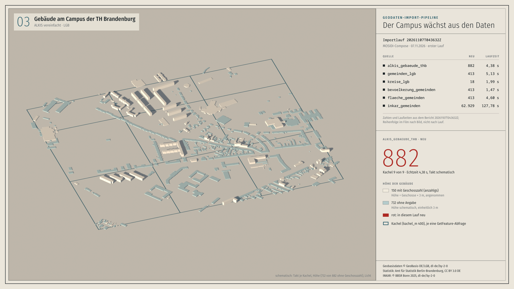
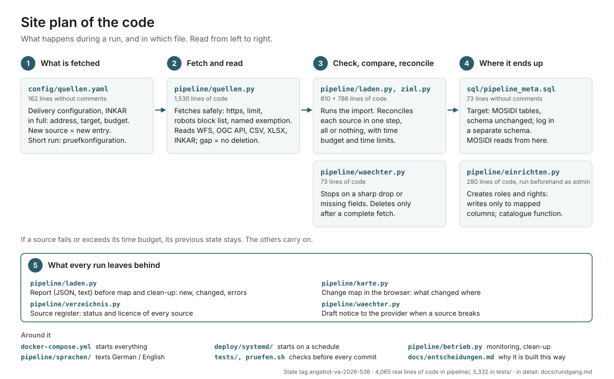

# Geodata Import Pipeline

Deutsch: [README.md](README.md)

 

**One real run, three films:** [andremadstop.github.io/geodaten-import-pipeline](https://andremadstop.github.io/geodaten-import-pipeline/) (map, terminal, explainer; captions in German). Every number comes from the run reports in `beispielberichte/`; scripts and sources in [`docs/filme/`](docs/filme/).

Loads geodata from WFS services, CSV tables, statistical reports (XLSX) and the INKAR complete file into PostgreSQL/PostGIS (EPSG:4326) automatically, with a report for every run. The prototype processes the documented example configurations. Each source runs in its own transaction; rows are deleted only after a fetch that is shown to be complete, and an empty result or a sharp drop stops the source. How far this goes is set out in the tests and in the limits in [`docs/entscheidungen.md`](docs/entscheidungen.md) (German); the pipeline refreshes the catalogue view (`source_granularities`) itself in a separate transaction after the sources (since E52 without blocking readers when the view has a unique index as in MOSIDI, with its own time limit and after writing the report first); checking inherited database permissions (PUBLIC, default privileges) is a separate operational step.

Prototype by Stiebitz Souverain Systems UG for tender VA-2026-536 of TH Brandenburg (Brandenburg University of Applied Sciences). The submitted state is the tag `angebot-va-2026-536` (state after E52 of 8 November 2026; what E52 adds to the state after E51 of 7 November 2026 is listed in the section “New since the state after E51”). The full evidence record of the states E46 to E52 with the table “For review in tender VA-2026-536” (unchanged up to E51, extended on 8 November 2026 by the row for the state after E52 and on 9 November 2026 by its full scope) is kept in [`docs/belege.en.md`](docs/belege.en.md). Writes into the existing tables of the MOSIDI platform (schema from the public repository MOSIDI-ORG/MOSIDI) without changing their schema. Written with AI assistance, reviewed and operated by us.

> **Note on languages:** This file is the English version of the README. The detailed documentation in `docs/` (operations, decisions, walkthrough, security, research, requirements matrix, handover) is in German for now; the links below point to the German files. The pipeline's outputs (run report, draft reports to providers, source register, change map) are available in German and English, see "Output language" below.

## What TH needs, and what already runs here

Every number comes from a run report or log in this repository; the “Evidence” column leads there. State of the figures: tests, test configuration, MOSIDI Compose and the shipped configuration in full scope with the value check of every row from the test record after E52 of 8/9 November 2026 ([`beispielberichte/pruefstand-2026-11-08-e52/`](beispielberichte/pruefstand-2026-11-08-e52/)); Germany, the follow-up run with a full comparison in full scope (after E52 the follow-up run skipped INKAR) and the disk usage during the runs from the test record after E51 of 7 November 2026 ([`beispielberichte/pruefstand-2026-11-07-e51/`](beispielberichte/pruefstand-2026-11-07-e51/), behaviour before E52). All runs on a development machine in parallel use, INKAR from the stored file. The matrix with every item of the specification, tests and status per item: [`docs/anforderungen.md`](docs/anforderungen.md) (German).

| Requirement (specification, TH answer) | Already runs here | Evidence |
|---|---|---|
| WFS services with paging, tiling and mapping onto the target schema (spec 4.1; WFS 2.0.0 and 1.1.0, answer 67) | 882 buildings, 413 municipalities and 18 districts from Geobasis Brandenburg in the existing tables; 9 tiles with 940 objects, each of the 882 buildings exactly once; 48 districts in 5 pages of at most 10; WFS 1.1.0 next to 2.0.0: 18 of 18 districts identical | [run, test configuration](beispielberichte/pruefstand-2026-11-08-e52/pruefkonfiguration/20261108T221635Z.txt), [tile borders](beispielberichte/kachelgrenzen/), [paging](beispielberichte/paging/), [WFS 1.1.0](beispielberichte/wfs-1.1.0/) |
| CSV and table sources, local or by URL, free column mapping (spec 4.1; answers 33, 49) | Population and area per municipality from the statistical report of the Office for Statistics Berlin-Brandenburg (XLSX by URL): 413 + 413 values, 413 of 413 area keys with a polygon in the municipality table, area check at most 0.398 % deviation; CSV adapter with header and footer block, reference date and statistical symbols | [run, test configuration](beispielberichte/pruefstand-2026-11-08-e52/pruefkonfiguration/20261108T221635Z.txt), [`config/quellen.yaml`](config/quellen.yaml) |
| INKAR in the scope of TH's preliminary work, fetched automatically by URL (spec 5; answers 33, 61) | Full scope: 33,547,606 rows, 355 indicator names, 10,978 municipalities, 1995 to 2024; first run 127.5 min (after E51 129.7 min); follow-up run with a full comparison 159.7 min after E51, below the time budget of 240 min, follow-up run without changes after E52 2.9 min (INKAR skipped, E52); value check of every row against the database: 0 missing, 0 surplus, 0 differing (after E52 as after E51). The fetch by URL is built but tested only against stand-ins: `www.bbr-server.de` disallows automated access in its robots.txt, the configuration carries TH's named permission | [runs in full scope](beispielberichte/pruefstand-2026-11-08-e52/quellen/), [value check](beispielberichte/pruefstand-2026-11-08-e52/wertabgleich/ergebnis-vollumfang.txt), [follow-up run with a full comparison](beispielberichte/pruefstand-2026-11-07-e51/quellen/20261107T065227Z.txt), [review of the preliminary work](docs/vorarbeiten-bewertung.md) (German) |
| Target data model unchanged, the three MOSIDI tables (spec 4.2; answers 26, 27, 47) | Writes into `table_metadata`, `dashboard_data_de` and the geometry tables, creates nothing in `public`; schema identical before and after the run; `table_metadata` after DCAT-AP with 360 rows after the full scope | [MOSIDI Compose](beispielberichte/pruefstand-2026-11-08-e52/mosidi-compose/), [database extract](beispielberichte/pruefstand-2026-11-08-e52/quellen/datenbank-auszug.txt), [database tests](tests/test_datenbank.py) |
| History as a log per run, counted by business key (spec 4.2; answers 25, 30, 51, 59, 62) | Per source new, changed, deleted, unchanged by business key, computed before the replacement; follow-up run in full scope: 33,547,606 unchanged, 0 changed; every change with its key in `pipeline_meta.aenderung` | [follow-up run](beispielberichte/pruefstand-2026-11-07-e51/quellen/20261107T065227Z.txt), [`sql/pipeline_meta.sql`](sql/pipeline_meta.sql) |
| Fault tolerance per source, deletion only after a complete fetch (spec 4.3; answer 52) | An unreachable source is rolled back, the others run; 5 instead of 48 districts: the previous data stays, a draft report to the provider is ready | [failure case](beispielberichte/20261030T074610Z.txt), [drop protection](beispielberichte/20261030T074631Z.txt), [draft report](beispielberichte/20261030T074631Z-meldung-kreise_bkg.txt) |
| Scheduled and manual, schedule per source (spec 4.3; answer 37) | systemd timer or `docker compose run`; third run of the test record 0.05 s (after E51 0.1 s), all six sources “not due” | [run 3](beispielberichte/pruefstand-2026-11-08-e52/quellen/20261109T005504Z.txt), [`deploy/systemd/`](deploy/systemd/) |
| Docker as a service in the MOSIDI Compose setup (spec 4.4; answers 36, 53) | Service `pipeline` next to `brandenburg_db` (PostgreSQL 18.6): two runs with exit code 0, catalogue `source_granularities` 0 → 11 rows (refreshed concurrently, CONCURRENTLY), schema `public` unchanged; credentials only via `.env` | [`deploy/mosidi/`](deploy/mosidi/), [Compose run](beispielberichte/pruefstand-2026-11-08-e52/mosidi-compose/) |
| Import report per run, machine- and human-readable (spec 4.5; answer 38) | JSON and text per run: timestamp, sources, failed sources with cause, counters per source, run time, warnings; plus change map and source register | [report as JSON](beispielberichte/pruefstand-2026-11-08-e52/quellen/20261108T224411Z.json), [as text](beispielberichte/pruefstand-2026-11-08-e52/quellen/20261108T224411Z.txt) |
| Tests and end-to-end run with WFS and CSV (spec 4.6, 11; answer 53) | At the submitted state (after E52) tests without a database 529 passed / 83 skipped, database tests 83 of 83 (PostgreSQL 16.15) and 83 of 83 (PostgreSQL 18.6), including an end-to-end test without external services and a restore check; after E51 the figures were 424 and 70 of 70; end-to-end against the real services in every test record with WFS, XLSX and INKAR | [`pruefen.log`](beispielberichte/pruefstand-2026-11-08-e52/pruefen.log), [`datenbanktests.log`](beispielberichte/pruefstand-2026-11-08-e52/datenbanktests.log), [CI](https://github.com/andremadstop/geodaten-import-pipeline/actions) |
| Scales to all of Germany, configuration only (answer 32) | 11,103 municipality polygons (VG250 of the BKG) and 1,640,420 INKAR values in 325.6 s, follow-up run 290.2 s unchanged | [Germany](beispielberichte/pruefstand-2026-11-07-e51/deutschland/), [`config/deutschland.yaml`](config/deutschland.yaml) |
| New sources without changing the core code (spec 8 no. 3; answer 64) | Six sources as entries in `config/quellen.yaml`; a new source of an existing type is an entry, one run of `einrichten`, one `--probelauf` | [`config/quellen.yaml`](config/quellen.yaml), [operations, “Neue Quelle”](docs/betrieb.md) (German) |
| Keeping the MOSIDI catalogue current on its own (answer 75) | `source_granularities` after every run with changes, since E52 without blocking readers where the view has MOSIDI's unique index (concurrently in the Compose run of 8 November), with its own time limit and the report written first; MOSIDI's `insert_table_metadata()` is not called, reasons in E52 | [Compose run](beispielberichte/pruefstand-2026-11-08-e52/mosidi-compose/), [E52](docs/entscheidungen.md) (German) |
| Spatial data stays, only attributes are replaced (answer 74) | Geometry tables with `loeschen: false`: the import role has no delete permission there | [database tests](tests/test_datenbank.py) |
| Documentation, data model, licence overview (spec 4.7, 7; answer 35) | Operations, walkthrough, decisions E1 to E52, security; data model commented in `sql/pipeline_meta.sql` and `config/quellen.yaml`; Apache-2.0, components with licences in `ACKNOWLEDGEMENTS.md`, bill of materials from `pruefen.sh` | [`docs/`](docs/), [`ACKNOWLEDGEMENTS.md`](ACKNOWLEDGEMENTS.md), [`LICENSE`](LICENSE) |
| Handover with training, video possible (spec 9; answers 39, 55) | Handover session prepared as a training with an operations checklist | [`docs/uebergabe.md`](docs/uebergabe.md) (German) |

## Check it yourself in a few steps

Needs [uv](https://docs.astral.sh/uv/) and Docker. The first two steps contact no geodata service (`pruefen.sh` only fetches the check tools and asks PyPI for known vulnerabilities of the dependencies); the first `docker compose run` builds the image, which takes a few minutes the first time.

    ./pruefen.sh                                     # ruff, bandit, pip-audit, tests without a database, secret scan, bill of materials
    less beispielberichte/pruefstand-2026-11-08-e52/quellen/20261108T224411Z.txt   # the first run in full scope; every report looks like this
    cp .env.beispiel .env && chmod 600 .env          # set three passwords, e.g. openssl rand -base64 24
    mkdir -p cache; [ "$(id -u)" = 1000 ] || chmod 777 berichte cache   # the container writes as UID 1000
    docker compose up -d db && docker compose run --rm einrichten
    docker compose run --rm pipeline --config /app/config/pruefkonfiguration.yaml --probelauf --nur gemeinden_lgb
    less berichte/*-probelauf.txt                    # 413 LGB municipalities read and compared, nothing written permanently

The last run contacts only `isk.geobasis-bb.de`. Without `--nur`, `--probelauf --alle` would also load INKAR by URL from a host whose robots.txt disallows automated access (TH's requirement, named permission in the configuration); for that, store the complete file first, see “Getting started”. Database tests against PostGIS: `docs/betrieb.md` and `.github/workflows/pruefen.yml`.

## Honestly: what is still missing

By 30 November 2026, within the fixed price of the bid:

- TH's feature types and further WFS services, state-wide measurement runs with time budget and tile size (work packages 1 and 2).
- INKAR: the first real fetch by URL in the acceptance run (so far tested only against stand-ins), the request to the BBSR about the robots.txt, the metadata of sheet ZOM (the pipeline does not write `dashboard_data_metadata`; work packages 1 and 3).
- The tables of the Office for Statistics that TH names (work package 3).
- Reconciliation with TH's DDL and the five points to clarify, among them the form of the INKAR code (the pipeline writes it with eight digits, TH's import with seven for 77 % of the rows in full scope) and the values of `source`; then the initial clean-up of existing attributes per source (work packages 1 and 4).
- Compose fix for PostgreSQL 18 (the unchanged `brandenburg_db` does not start on a new volume) and the check of direct `TRUNCATE` permissions of the import role (work package 6).
- The full scope in the MOSIDI Compose setup and the duration of the catalogue refresh afterwards are not measured; all run times come from the development machine, not the target machine (work package 8).
- Guide “connecting a new source” and operations documentation in English; `docs/` is German for now (work package 9).
- The test record for the state after E52 of 8 November 2026 ([`beispielberichte/pruefstand-2026-11-08-e52/`](beispielberichte/pruefstand-2026-11-08-e52/)) covers tests, test configuration, Compose and, completed on 9 November 2026, the shipped configuration in full scope with the value check of every row (0/0/0) and a follow-up run that skips the unchanged INKAR file (2.9 min). Not measured at the state after E52 are Germany (state after E51), a follow-up run with a full comparison in full scope (after E51 159.7 min) and the concurrent catalogue refresh after 33.5 million rows (as after E51, the full scope ran in a database without the catalogue view). Codex reviewed all four E52 items in an overall review against the state after E51, two of them (total count during paging, scope change) only there; the corrections made after that review were checked only by us (E52, “Gesamtprüfung durch Codex”). After that came the end-to-end test with the restore check, the acceptance criteria and a behaviour-neutral clean-up of the E52 code; Codex has not seen these, they were cross-read in a second, independent review without Codex (E52).

Limits that remain:

- A damaged key consisting only of digits goes unnoticed in statistics tables (E47); the count check when skipping unchanged files (E52) does not see changes that keep the row count, only the next full reconciliation does.
- The change map shows at most 20,000 objects per source; only the report and the log are complete. Warnings from the sources, `--status` and `--kennzahlen` are German.
- After the INKAR full scope the database takes about 24 GB, at least 66 GB during the runs; the register `pipeline_meta.bestand` alone 12 GB.

## New since the state after E51 (E52, 8 November 2026)

Four ideas from a review of other providers' public repositories, built our own way, no foreign code ([`docs/entscheidungen.md`](docs/entscheidungen.md), E52, German):

- **Skip an unchanged delivery** (`unveraendert_ueberspringen`, shipped only for INKAR): byte-identical file, same fingerprint of configuration and code, count check passed and last full reconciliation younger than `vollabgleich_tage`, then no writes to the data; `--vollabgleich` forces the full reconciliation. Duration of a skipped INKAR run in full scope: 2.9 min instead of 159.7 min after E51 (INKAR 111.6 s instead of 9,493.0 s; checksum and count check, [test record after E52](beispielberichte/pruefstand-2026-11-08-e52/README.md)).
- **Catalogue the MOSIDI way:** `REFRESH MATERIALIZED VIEW CONCURRENTLY` where the view has the unique index; report before the computation; own time limit (`katalog_zeitlimit_min`, default 20 min); `dcat_ap_id` by MOSIDI's formula, only where empty.
- **Total count before and after paging:** if a WFS changes its hit count during a paged fetch, the fetch counts as incomplete and deletes nothing.
- **Block a scope change:** if address, extent, key or target of a source change and the run would therefore delete, the source stops until someone confirms with `--umfang-bestaetigen SOURCE` or `umfang_bestaetigt`.

## Who gets what out of it

| Who | What the pipeline does for them | Where to read |
|---|---|---|
| Data centre, administration | runs as a service in the existing Compose setup, by timer or by hand; configuration via environment variables, database roles with least privilege, `--status` for monitoring, `--ziele` for the firewall | [docs/betrieb.md](docs/betrieb.md) (German), [SECURITY.md](SECURITY.md) |
| Development | a new source is an entry in `config/quellen.yaml`, one run of `einrichten`, one dry run; adapters only for special formats; `pruefen.sh` and database tests in CI | [docs/](docs/), `config/`, `tests/` |
| Research and data users | every run has an ID with timestamp, and the change log in `pipeline_meta` tells what has changed per source since; provenance and licence are stored per source in the configuration, in `table_metadata` (DCAT-AP) and in the source register, so figures can carry the correct attribution | [docs/forschung.md](docs/forschung.md) (German), `berichte/quellenverzeichnis.md` |
| Project management | `--kennzahlen` summarises a reporting period from the run reports (runs, sources, changes, intercepted source failures) for progress reports and funding statements | [docs/forschung.md](docs/forschung.md) (German) |
| Data providers | requests run one after another with a user agent and pauses, fixed block list in the code, derived from each host's robots.txt (the one named permission for INKAR is stated in the configuration and in every report); on findings a draft message is prepared, nothing is sent automatically | [docs/betrieb.md](docs/betrieb.md) (German), `berichte/` |

**Citing.** The repository ships a `CITATION.cff` (GitHub: "Cite this repository", APA and BibTeX). No DOI has been assigned to this state yet; one per version can be minted through Zenodo's GitHub integration, the steps are in [docs/forschung.md](docs/forschung.md) (German). Anyone publishing an analysis cites the run ID of the data state alongside.

## What it does

- **One command, manually or on a schedule:** One command loads all active sources of the configuration. A new source of an existing type (WFS, CSV, XLSX, OGC API Features, GeoJSON, INKAR) is an entry in `config/quellen.yaml`, not code (for WFS the object ID from a child element or from the feature's `gml:id`, E51; differing business keys or metadata structures may require a change in the adapter); plus one run of `einrichten` as administrator so the import role gets rights on the new columns, then a dry run.
- **Traceable:** Every run writes a report: per source new, changed, deleted, unchanged, with warnings and causes; the same as a log per run and per change in the separate schema `pipeline_meta` (TH answers 30 and 51).
- **Robust against the sources themselves:** If a source fails, collapses or lacks configured fields, the previous data stays in place and a ready-made draft report to the provider is written. Every source has a time budget, since E51 also for its database statements (`statement_timeout`, `lock_timeout` per transaction): if another session locks a target table, only this source is rolled back after the wait limit, and the next one runs. Geometries that are unreadable, still unusable after `ST_MakeValid` or not convertible to the type of the target column are skipped per object (repair, transformation and type per object, E46); the fetch then counts as incomplete and nothing is deleted for that source in that run. Invalid geometries are repaired; rows without a mandatory value are skipped with a warning and keep their previous value. Only a fetch shown to be complete may delete: a WFS tile without a total count needs the service's `CountDefault`, a hit count or an empty follow-up page preceded by as many distinct objects as counted (a service that does not page stays incomplete without a total count; E47); a data row of a statistics table without a valid key (empty, letters, spaces, tab, quotes) blocks deletion even when the area filter skips it; after the data range only clearly recognisable footer rows are allowed, a damaged last data row blocks deletion (E51; likewise doubtful remaining rows in XLSX and INKAR); a damaged key that consists only of digits goes unnoticed (E47); OGC API follow-up links without progress end the fetch as incomplete (E47). All of this is in the report.
- **Test new sources safely:** `--probelauf` (dry run) reads, checks and compares the sources that are due (a file source with `unveraendert_ueberspringen` whose file is byte-identical is skipped as in a regular run and then not checked; a complete check with `--probelauf --vollabgleich --alle` or `--nur QUELLE`, E52) without lasting changes to the data (every transaction is rolled back; a sequence used by a target table still advances); it writes only the check report and, where a source uses it, the download cache.
- **Change map per run:** an HTML page next to the report gives an overview of what the run created, changed and deleted per source (example with invented data in `beispielberichte/aenderungskarte/`). It shows at most 20,000 objects per source (changes first, also before withheld objects, E50) and figures aggregated per area; only the report and the log are complete. Leaflet is embedded in the page, which loads nothing from the network; background maps (basemap.de, LGB aerial images) only with `karte.hintergrund`, no map at all with `karte: false` ([docs/betrieb.md](docs/betrieb.md), German).
- **TH sources set up in the configuration** (shown in the example runs with the test configuration: campus buildings, all municipalities and districts of Brandenburg, five INKAR indicator codes, population and area per municipality; the full INKAR scope of the TH's import measured with a test configuration, 33,547,606 rows in 146.5 min, and since E51 the shipped configuration, measured at the state after E51 with a first run of 129.7 min, a follow-up run of 159.7 min and a value check of every row, at the state after E52 with a first run of 127.5 min, a value check of every row and a follow-up run without changes in 2.9 min that skips the unchanged INKAR file; further services and tables follow in work package 1): Geobasis Brandenburg WFS (ALKIS buildings, municipalities, districts); INKAR (BBSR) as a dedicated source type, fetched automatically by URL with a named permission (E50), that streams the 434 MB complete file and, like TH's own import, writes one row per indicator, municipality and year; and the statistical report of the Office for Statistics Berlin-Brandenburg (total population, area per municipality) as XLSX through the type `xlsx`, configuration only (E48; the report is available as XLSX, not as CSV). The figures are linked to the municipality polygons via the AGS key (business key, TH answer 28). Services offering OGC API - Features have their own adapter.
- **Mapping in the configuration:** Which source writes into which table and columns, with a business key per source (TH answer 31) and a schedule per source (TH answer 37), is set in `config/quellen.yaml` under `ziel` and `rhythmus`. If the DDL TH provides at project start differs, usually only the configuration is adapted; differing business keys or metadata structures may require a change in the adapter.
- **MOSIDI schema unchanged:** The pipeline creates nothing in `public` and changes no schema; it updates only mapped columns (columns MOSIDI fills itself, such as `flood_risk`, stay) and deletes only rows it wrote itself, and only after a complete, error-free retrieval (TH answer 52). Since E52 a paged WFS retrieval counts as incomplete if the service's total count changes during paging, and after a change to a source's scope (address, extent, key, target) a run deletes only once someone confirms it (`--umfang-bestaetigen SOURCE`). A test compares tables, columns and constraints before and after a run.
- **Source register:** After every run an overview of all sources with provider, contact, licence, last successful retrieval and count (`berichte/quellenverzeichnis.md`).
- **Secure in operation:** own database role without schema rights, write access only to the mapped columns (`einrichten` revokes surplus ones, E46; if an existing role has attributes such as SUPERUSER or CREATEDB or is a member of another role, `einrichten` aborts, E47), only one run per database at a time (lock in the report folder and in the database), hardened container, base image pinned by digest, Python dependencies pinned with versions and hashes, check tools at fixed versions (without hashes; Debian packages of the image, uv itself and the Python version of the check environment not pinned, E51), and vulnerability scanning. Details in [docs/sicherheit.md](docs/sicherheit.md) (German).

## Getting started

    cp .env.beispiel .env          # set a separate password per role, chmod 600
    docker compose up -d db                       # test database with the MOSIDI tables
    docker compose run --rm einrichten            # pipeline_meta, roles, permissions (once)
    docker compose run --rm pipeline              # all sources that are due (schedule per source)
    docker compose run --rm pipeline --alle       # all sources, due or not
    docker compose run --rm pipeline --nur NAME   # one source
    docker compose run --rm pipeline --probelauf  # check the due sources (unchanged file sources skipped, E52; complete with --vollabgleich --alle), no lasting data changes (writes report, cache)
    docker compose run --rm --no-deps pipeline --status       # state for monitoring
    docker compose run --rm --no-deps pipeline --kennzahlen   # summary for reports

**INKAR in regular operation and in test runs** (E50, E51): in regular operation `pipeline` fetches INKAR automatically by URL, as the TH requires (answer 33), and since E51 in full scope (all indicators for all municipalities in Germany, measured at the state after E51 at 130 min for the first run and 160 min for the follow-up run with a full comparison, at the state after E52 at 128 min for the first run and 3 min for a follow-up run with an unchanged file within `vollabgleich_tage`, database afterwards about 24 GB, at least 66 GB during the run). The `--probelauf` above therefore checks the full scope as well. For a quick first check (about 2.5 min, INKAR with five codes for Brandenburg) run the test configuration as a dry run: `docker compose run --rm pipeline --config /app/config/pruefkonfiguration.yaml --probelauf --alle`. It uses the same source names as the shipped configuration; a regular run with it against the production database would reduce INKAR to five codes and restart the schedule of that source or, if the database already holds INKAR in full scope, stop at the decline guard (with a draft report to the provider), so use it only as a dry run or in a separate test database. The host `www.bbr-server.de` disallows automated access in its robots.txt; `config/quellen.yaml` therefore carries a named permission (`robots_freigabe`), which every report, the log and `--ziele` show. For a test run without network access, put the complete file into `cache/` and set `PIPELINE_INKAR_DATEI=/app/cache/inkar_2025.zip` in `.env` (both Compose files pass the variable on); the evidence runs in `beispielberichte/` were made this way. Details in [docs/betrieb.md](docs/betrieb.md) (German), section “Quellen und Abrufregeln”.

**Output language:** The run report, draft reports to providers, source register and change map are available in German and English, selected with `sprache: en` in the configuration or `PIPELINE_SPRACHE=en`. The texts live in `pipeline/sprachen/de.json` and `en.json`; another language is another file, missing texts fall back to German. Warnings and notes coming from the sources stay German (decision E21). The `--status` line for monitoring and `--kennzahlen` are German as well.

In the MOSIDI Compose setup: [deploy/mosidi/](deploy/mosidi/README.md) (German; services `pipeline-einrichten` and `pipeline` next to `brandenburg_db`).

Scheduled: ready-made systemd units in `deploy/systemd/` (daily timer, notification on failure), set-up in [docs/betrieb.md](docs/betrieb.md) (German). Which hosts must be reachable: `docker compose run --rm --no-deps pipeline --ziele`. Exit code 1 if a source failed, was stopped or retrieved incompletely, 2 on a technical abort (then with a report, where writable).

## Structure

| Part | File |
|---|---|
| Sources (configuration; table and field mappings without code changes, differing keys or metadata possibly in the adapter); shipped configuration with full INKAR scope, test configuration with five INKAR codes (E51) | `config/quellen.yaml`, `config/pruefkonfiguration.yaml` |
| Adapters for WFS 2.0 (STARTINDEX paging, otherwise tiling of the BBOX), OGC API - Features (GeoJSON, follow-up links only to the same host), CSV (local/URL, WKT, x/y or area key; statistics tables with header and footer block, reference date, statistical symbols), XLSX (statistical reports: sheets and columns by their labels, reference date from the file, sum check, link from the report page only to permitted hosts, no DTD and through defusedxml), INKAR (ZIP streamed, limits against ZIP bombs, long format per area) and GeoJSON files (streamed, one feature at a time, e.g. Eurostat GISCO); secure retrieval | `pipeline/quellen.py` |
| Loading per source, schedule, errors per source, report, log | `pipeline/laden.py` |
| Writing into the existing tables: check against the catalogue, comparison with the register, reconciliation, `table_metadata` (DCAT-AP) | `pipeline/ziel.py` |
| Source guard: schema comparison, drop protection, draft report to the provider | `pipeline/waechter.py` |
| Source register | `pipeline/verzeichnis.py` |
| Monitoring (`--status`), key figures (`--kennzahlen`), retention, data archive | `pipeline/betrieb.py` |
| Change map per run (Leaflet embedded from `pipeline/vendor/`; basemap.de, LGB aerial images only on request) | `pipeline/karte.py` |
| Output languages | `pipeline/sprache.py`, `pipeline/sprachen/*.json` |
| Separate schema `pipeline_meta`: run log, changes per run, register of written rows, source state | `sql/pipeline_meta.sql` |
| Roles and permissions derived from the targets in the configuration (write permissions down to the column; permissions inherited via PUBLIC or default privileges are a separate operational step, docs/sicherheit.md) | `pipeline/einrichten.py` |
| MOSIDI tables for the test environment (as in the public repository, reconciled with the delivered DDL in work package 1) | `sql/mosidi/001_bestand.sql` |
| Integration into the MOSIDI Compose setup | `deploy/mosidi/` |
| Checks (ruff, bandit, pip-audit, pytest, secret scan, SBOM), locally and in CI; plus tests against a real PostGIS database as a separate CI job | `pruefen.sh`, `tests/test_datenbank.py`, `.github/` |
| Scheduling and failure notification (systemd) | `deploy/systemd/` |
| Reports per run (JSON + text) and draft reports | `berichte/`, examples in `beispielberichte/` |

- **Reconcile instead of versioning** (TH requirement): A new import overwrites the data of the same source; earlier versions are not kept in the tables. Before that, the pipeline compares the new state with what it wrote for this source (register in `pipeline_meta`; geometry rounded to 1e-7 degrees, values exact) and counts new, changed, deleted and unchanged. Report and log per run are the history (TH answer 30).
- **Drop protection:** If a source returns 0 objects or less than half of the previous number, the previous data stays (per source `max_rueckgang`). The same applies if configured fields are missing in the source; otherwise an attribute would silently disappear from all objects. An empty delivery confirmed by the provider can be accepted for exactly one run with `--leerlieferung SOURCE "REASON"` (E50).
- **Coordinate system:** All geometries are transformed to EPSG:4326; the source CRS comes from the GML or the configuration.
- **Tables without coordinates** (e.g. INKAR, statistical offices): rows carry the area key (AGS) as a business key, not a foreign key (TH answer 28). With an area table configured (`ziel.gebiet`), each run checks how many keys have a polygon in the municipality table and reports the others; the delivery configuration does not set it for INKAR, because the municipality polygons in MOSIDI cover Brandenburg only (`config/deutschland.yaml` shows the link with VG250). Missing leading zeros are added via `schluessel_laenge`.
- **Errors per source:** each source in its own transaction. If it fails or exceeds its time budget (`zeitbudget_min`, default 30 min, E50; since E51 also a database time limit: `statement_timeout` = remaining budget, `lock_timeout` at most `db_sperre_max_s`, default 300 s), it is rolled back, the report gives the cause, the other sources continue. Limit: a write step made of several statements does not reset the limit before each statement. The whole run is bounded by `TimeoutStartSec=7h` of the systemd units (above the sum of the time budgets).
- **Matching without current statistics:** the import role may not analyse MOSIDI's tables. So that a freshly written range does not push the comparison into a quadratic loop (reproduced: 40,000 rows 89 s instead of 2 s), each source is matched without nested loops, using hash or merge joins (E31).
- **Overlong texts:** nothing is truncated (E47; up to E46 the database stored overlong texts truncated, E31). A date of the form `YYYY-MM-DDZ` (time zone designator Z, as the ALKIS WFS delivers `aktualit`) is taken without the Z when the column is too short for it; the day stays the same, and the report counts it as a note. Any other overlong value holds back its row: a new object is not created, an existing one keeps its previous state and is not deleted; the report warns with count, maximum length and keys. If a key column or a fixed value from the configuration is affected, the source is halted (E32, E47).

## Understanding the code

The **site plan** above is the quickest way in: five steps, each with its file and one sentence on what happens there. For more depth, read the walkthrough next.

The following documents are in German.

- **[Requirements matrix](docs/anforderungen.md):** every item of the specification and every relevant TH answer with implementation, test, evidence and status (shown, by 30 November, to clarify in work package 1).
- **[Handover](docs/uebergabe.md):** the handover session as a training, what TH can do on its own afterwards, operations checklist.
- **[TH's preliminary work](docs/vorarbeiten-bewertung.md):** review and assessment of the INKAR import in MOSIDI (specification 5), what is taken over and what is not, with reasons.
- **[Evidence record](docs/belege.en.md)** (English): the states E46 to E51 with all figures and run reports, as they stood at the top of this README until E52, extended on 8 November 2026 by the state after E52 and on 9 November 2026 by its full scope.
- **[For proposals and reports](docs/forschung.md):** FAIR principles, citation via `CITATION.cff` and Zenodo DOI, key figures from the run reports, reuse, sentences ready to copy.
- **[Operations](docs/betrieb.md):** for the data centre: fact sheet, set-up with systemd timer (`deploy/systemd/`), firewall rules via `--ziele`, proxy, monitoring, troubleshooting table, backup, updates.
- **[Decisions](docs/entscheidungen.md):** why the pipeline is built this way; per decision the occasion, options, rationale and when to revisit it.
- **[Walkthrough](docs/rundgang.md):** one run from start to finish in thirteen steps, each with what happens and why it is built that way. Intended for the handover.
- **[Code map](docs/codekarte/README.md)** (state after E51 of 7 November, before E52): the code as a city, area by lines of code, height and colour by complexity.
- **Templates** (`docs/vorlagen/`): acceptance protocol following sections 8 and 11 of the specification, project fact sheet for reports and proposals.

## Checks

    ./pruefen.sh

Needs only [uv](https://docs.astral.sh/uv/). The same checks run in CI on every push and weekly.

## Data and licences

Who this pipeline owes what, tool by tool: [ACKNOWLEDGEMENTS.md](ACKNOWLEDGEMENTS.md).

ALKIS simplified (WFS), © GeoBasis-DE/LGB, dl-de/by-2-0. VG250 districts (WFS), © BKG (2026) dl-de/by-2-0. Administrative boundaries of Brandenburg, municipalities and districts (WFS), © GeoBasis-DE/LGB, dl-de/by-2-0. Municipalities of Brandenburg (OGC API - Features, earlier example runs), © GeoBasis-DE/LGB, dl-de/by-2-0. INKAR, © BBSR Bonn 2025, dl-de/by-2-0 (delivery configuration: all indicators per municipality in Germany, full scope like the TH import; test configuration: five codes in Brandenburg; previously an extract: selected indicators per municipality in Brandenburg). Population and area per municipality (statistical report A I 4 / A V 2 – j/25 BB, XLSX), Amt für Statistik Berlin-Brandenburg, CC BY 3.0 DE (until E47 from the Regional Database, © Statistische Ämter des Bundes und der Länder, dl-de/by-2-0; no longer fetched since E48). Municipalities (LAU 2024) with population and area, Europe trial run only (`beispielberichte/europa/`), Eurostat GISCO, © EuroGeographics for the administrative boundaries; no commercial use under the GISCO download rules. In the change map: Leaflet 1.9.4 (BSD-2-Clause), in the repository under `pipeline/vendor/leaflet-1.9.4/` and embedded; only when switched on basemap.de Web Raster grey, © GeoBasis-DE / BKG (2026), dl-de/by-2-0, and aerial image DOP20, © GeoBasis-DE/LGB, dl-de/by-2-0. Code map generated with CodeCharta (BSD-3-Clause). Sample CSVs created by us.
Components: Python 3.12 (PSF), unzip (Info-ZIP licence, Debian package), psycopg (LGPL-3.0), lxml (BSD-3), PyYAML (MIT), requests (Apache-2.0), openpyxl (MIT) with et-xmlfile (MIT), defusedxml (PSF-2.0), PostGIS (GPL-2.0), PostgreSQL (PostgreSQL License). Bill of materials of the Python dependencies (versions and hashes from `requirements.txt`): `./pruefen.sh` creates `sbom.cdx.json`; Debian packages of the image, Leaflet, database and checking tools are not in it but listed with licences in `ACKNOWLEDGEMENTS.md`. Imported source data are not in the current state of the repository: the example reports contain counts, run times and object IDs in warnings, no records (answer 69). Only the submitted state is published, as a single commit (tag `angebot-va-2026-536`); older development commits that still contained source data are not part of it (E43).
Licence of the code: Apache-2.0 (see `LICENSE` and `NOTICE`, since 3 November 2026, previously EUPL-1.2; decision E25), © 2026 Stiebitz Souverain Systems UG (haftungsbeschränkt). The file `sql/mosidi/001_bestand.sql` reproduces the public MOSIDI schema. Please report security vulnerabilities as described in [SECURITY.md](SECURITY.md).
