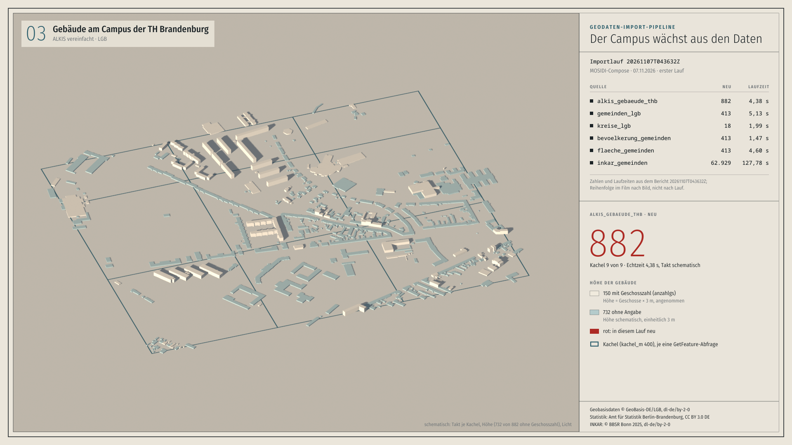

# Geodaten-Import-Pipeline

English: [README.en.md](README.en.md)

 

**Ein echter Lauf in drei Filmen:** [andremadstop.github.io/geodaten-import-pipeline](https://andremadstop.github.io/geodaten-import-pipeline/) (Karte, Terminal, Erklärfilm). Jede Zahl darin stammt aus den Laufberichten unter `beispielberichte/`; Skripte und Herkunft in [`docs/filme/`](docs/filme/).

Holt Geodaten aus WFS-Diensten, CSV-Tabellen, Statistischen Berichten (XLSX) und der INKAR-Gesamtdatei automatisch in PostgreSQL/PostGIS (EPSG:4326), mit Bericht je Lauf. Der Prototyp verarbeitet die dokumentierten Beispielkonfigurationen. Jede Quelle läuft in einer eigenen Transaktion; gelöscht wird nur nach belegt vollständigem Abruf, eine Nullmenge oder ein starker Rückgang hält die Quelle an. Wie weit das trägt, sagen die Tests und die Grenzen in [`docs/entscheidungen.md`](docs/entscheidungen.md); den Katalog (`source_granularities`) aktualisiert die Pipeline nach den Quellen in eigener Transaktion selbst (seit E52 ohne Sperre für Leser, wenn die View wie bei MOSIDI einen eindeutigen Index hat, mit eigenem Zeitlimit und nach einem Bericht vorab), die Prüfung geerbter Datenbankrechte (PUBLIC, Standardrechte) ist ein gesonderter Betriebsschritt.

Prototyp der Stiebitz Souverain Systems UG zur Ausschreibung VA-2026-536 der TH Brandenburg. Der Abgabestand ist der Tag `angebot-va-2026-536` (Stand nach E52 vom 08.11.2026; was E52 gegenüber dem Stand nach E51 vom 07.11.2026 hinzufügt, steht im Abschnitt „Neu seit dem Stand nach E51“). Die vollständige Belegchronik der Stände E46 bis E52 mit der Tabelle „Zur Prüfung im Vergabeverfahren“ (bis E51 unverändert, am 08.11.2026 um die Zeile zum Stand nach E52 ergänzt, am 09.11.2026 um dessen Vollumfang) steht in [`docs/belege.md`](docs/belege.md). Schreibt in die Bestandstabellen der Plattform MOSIDI (Schema aus dem öffentlichen Repository MOSIDI-ORG/MOSIDI), ohne deren Schema zu verändern. Mit KI-Unterstützung geschrieben, von uns geprüft und betrieben.

## Was die TH braucht, läuft hier schon

Jede Zahl stammt aus einem Laufbericht oder Protokoll in diesem Repository, die Spalte „Beleg“ führt hin. Stand der Zahlen: Tests, Prüfkonfiguration, Compose von MOSIDI und Lieferkonfiguration im Vollumfang mit Wertabgleich je Zeile aus dem Prüfstand nach E52 vom 08./09.11.2026 ([`beispielberichte/pruefstand-2026-11-08-e52/`](beispielberichte/pruefstand-2026-11-08-e52/)); Deutschland, der Folgelauf mit vollem Vergleich im Vollumfang (nach E52 hat der Folgelauf INKAR übersprungen) und der Plattenbedarf während der Läufe aus dem Prüfstand nach E51 vom 07.11.2026 ([`beispielberichte/pruefstand-2026-11-07-e51/`](beispielberichte/pruefstand-2026-11-07-e51/), Verhalten vor E52). Alle Läufe auf einem parallel genutzten Entwicklungsrechner, INKAR aus der abgelegten Datei. Die Matrix mit allen Punkten der Leistungsbeschreibung, Tests und Status je Punkt: [`docs/anforderungen.md`](docs/anforderungen.md).

| Anforderung (Leistungsbeschreibung, Antwort der TH) | Läuft hier schon | Beleg |
|---|---|---|
| WFS-Dienste mit Paginierung, Kachelung und Zuordnung auf das Zielschema (LB 4.1; WFS 2.0.0 und 1.1.0, Antwort 67) | 882 Gebäude, 413 Gemeinden und 18 Kreise der Geobasis Brandenburg in den Bestandstabellen; 9 Kacheln mit 940 Objekten, jedes der 882 Gebäude genau einmal; 48 Kreise in 5 Seiten zu höchstens 10; WFS 1.1.0 neben 2.0.0: 18 von 18 Kreisen gleich | [Lauf Prüfkonfiguration](beispielberichte/pruefstand-2026-11-08-e52/pruefkonfiguration/20261108T221635Z.txt), [Kachelgrenzen](beispielberichte/kachelgrenzen/), [Paging](beispielberichte/paging/), [WFS 1.1.0](beispielberichte/wfs-1.1.0/) |
| CSV- und Tabellenquellen lokal oder per URL, Spalten frei zuordenbar (LB 4.1; Antworten 33, 49) | Bevölkerung und Gebietsfläche je Gemeinde aus dem Statistischen Bericht des Amts für Statistik Berlin-Brandenburg (XLSX per URL): 413 + 413 Werte, 413 von 413 Gebietsschlüsseln mit Fläche in der Gemeindetabelle, Flächenprüfung höchstens 0,398 % Abweichung; CSV-Adapter mit Kopf- und Fußblock, Stichtag und statistischen Zeichen | [Lauf Prüfkonfiguration](beispielberichte/pruefstand-2026-11-08-e52/pruefkonfiguration/20261108T221635Z.txt), [`config/quellen.yaml`](config/quellen.yaml) |
| INKAR im Umfang der Vorarbeiten der TH, Abruf automatisch per URL (LB 5; Antworten 33, 61) | Vollumfang: 33 547 606 Zeilen, 355 Indikatornamen, 10 978 Gemeinden, 1995 bis 2024; Erstlauf 127,5 min (nach E51 129,7 min); Folgelauf mit vollem Vergleich 159,7 min nach E51 unter dem Zeitbudget von 240 min, Folgelauf ohne Änderung nach E52 2,9 min (INKAR übersprungen, E52); Wertabgleich jeder Zeile gegen die Datenbank 0 fehlend, 0 überzählig, 0 abweichend (nach E52 wie nach E51). Der Abruf per URL ist gebaut, aber nur mit Attrappen getestet: `www.bbr-server.de` sperrt automatische Abrufe per robots.txt, die Konfiguration trägt die benannte Freigabe der TH | [Läufe im Vollumfang](beispielberichte/pruefstand-2026-11-08-e52/quellen/), [Wertabgleich](beispielberichte/pruefstand-2026-11-08-e52/wertabgleich/ergebnis-vollumfang.txt), [Folgelauf mit vollem Vergleich](beispielberichte/pruefstand-2026-11-07-e51/quellen/20261107T065227Z.txt), [Sichtung der Vorarbeiten](docs/vorarbeiten-bewertung.md) |
| Zieldatenmodell unverändert, drei Tabellen von MOSIDI (LB 4.2; Antworten 26, 27, 47) | Schreibt in `table_metadata`, `dashboard_data_de` und die Geometrietabellen, legt in `public` nichts an; Schema vor und nach dem Lauf gleich; `table_metadata` nach DCAT-AP mit 360 Zeilen nach dem Vollumfang | [Compose von MOSIDI](beispielberichte/pruefstand-2026-11-08-e52/mosidi-compose/), [Datenbankauszug](beispielberichte/pruefstand-2026-11-08-e52/quellen/datenbank-auszug.txt), [Datenbanktests](tests/test_datenbank.py) |
| Historisierung als Protokoll je Lauf, fachlich gezählt (LB 4.2; Antworten 25, 30, 51, 59, 62) | Je Quelle neu, geändert, gelöscht, unverändert über den fachlichen Schlüssel, berechnet vor dem Ersatz; Folgelauf im Vollumfang: 33 547 606 unverändert, 0 geändert; jede Änderung mit Schlüssel in `pipeline_meta.aenderung` | [Folgelauf](beispielberichte/pruefstand-2026-11-07-e51/quellen/20261107T065227Z.txt), [`sql/pipeline_meta.sql`](sql/pipeline_meta.sql) |
| Fehlertoleranz je Quelle, Löschen nur nach vollständigem Abruf (LB 4.3; Antwort 52) | Eine unerreichbare Quelle wird zurückgerollt, die übrigen laufen; 5 statt 48 Kreise: der alte Stand bleibt, ein Meldungsentwurf an den Anbieter liegt bereit | [Fehlerfall](beispielberichte/20261030T074610Z.txt), [Rückgang-Schutz](beispielberichte/20261030T074631Z.txt), [Meldungsentwurf](beispielberichte/20261030T074631Z-meldung-kreise_bkg.txt) |
| Zeitgesteuert und von Hand, Rhythmus je Quelle (LB 4.3; Antwort 37) | systemd-Timer oder `docker compose run`; dritter Lauf des Prüfstands 0,05 s (nach E51 0,1 s), alle sechs Quellen „nicht fällig“ | [Lauf 3](beispielberichte/pruefstand-2026-11-08-e52/quellen/20261109T005504Z.txt), [`deploy/systemd/`](deploy/systemd/) |
| Docker als Dienst im Compose von MOSIDI (LB 4.4; Antworten 36, 53) | Dienst `pipeline` neben `brandenburg_db` (PostgreSQL 18.6): zwei Läufe mit Rückgabe 0, Katalog `source_granularities` 0 → 11 Zeilen (gleichzeitig, CONCURRENTLY), Schema `public` unverändert; Zugangsdaten nur über `.env` | [`deploy/mosidi/`](deploy/mosidi/), [Compose-Lauf](beispielberichte/pruefstand-2026-11-08-e52/mosidi-compose/) |
| Import-Bericht je Lauf, maschinen- und menschenlesbar (LB 4.5; Antwort 38) | JSON und Text je Lauf: Zeitstempel, Quellen, fehlgeschlagene Quellen mit Ursache, Zähler je Quelle, Laufzeit, Warnungen; dazu Änderungskarte und Quellenverzeichnis | [Bericht als JSON](beispielberichte/pruefstand-2026-11-08-e52/quellen/20261108T224411Z.json), [als Text](beispielberichte/pruefstand-2026-11-08-e52/quellen/20261108T224411Z.txt) |
| Tests und End-to-End-Lauf mit WFS und CSV (LB 4.6, 11; Antwort 53) | Am Abgabestand (nach E52) Tests ohne Datenbank 529 bestanden / 83 übersprungen, Datenbanktests 83 von 83 (PostgreSQL 16.15) und 83 von 83 (PostgreSQL 18.6), darunter ein Ende-zu-Ende-Test ohne fremde Dienste und eine Wiederherstellungsprobe; nach E51 waren es 424 und 70 von 70; End-to-End gegen die echten Dienste in jedem Prüfstand mit WFS, XLSX und INKAR | [`pruefen.log`](beispielberichte/pruefstand-2026-11-08-e52/pruefen.log), [`datenbanktests.log`](beispielberichte/pruefstand-2026-11-08-e52/datenbanktests.log), [CI](https://github.com/andremadstop/geodaten-import-pipeline/actions) |
| Skalierbar auf ganz Deutschland, nur andere Konfiguration (Antwort 32) | 11 103 Gemeindeflächen (VG250 des BKG) und 1 640 420 INKAR-Werte in 325,6 s, Folgelauf 290,2 s unverändert | [Deutschland](beispielberichte/pruefstand-2026-11-07-e51/deutschland/), [`config/deutschland.yaml`](config/deutschland.yaml) |
| Neue Quellen ohne Codeänderung an der Kernlogik (LB 8 Nr. 3; Antwort 64) | Sechs Quellen als Einträge in `config/quellen.yaml`; eine neue Quelle eines vorhandenen Typs ist ein Eintrag, einmal `einrichten`, ein `--probelauf` | [`config/quellen.yaml`](config/quellen.yaml), [Betrieb, „Neue Quelle“](docs/betrieb.md) |
| Katalog von MOSIDI eigenständig aktuell halten (Antwort 75) | `source_granularities` nach jedem Lauf mit Änderungen, seit E52 ohne Sperre für Leser, wo die View den eindeutigen Index von MOSIDI hat (im Compose-Lauf vom 08.11. gleichzeitig), mit eigenem Zeitlimit und Bericht vorab; `insert_table_metadata()` von MOSIDI wird nicht aufgerufen, Gründe in E52 | [Compose-Lauf](beispielberichte/pruefstand-2026-11-08-e52/mosidi-compose/), [E52](docs/entscheidungen.md) |
| Raumdaten bleiben, nur Attribute werden ersetzt (Antwort 74) | Geometrietabellen mit `loeschen: false`: die Importrolle hat dort kein Löschrecht | [Datenbanktests](tests/test_datenbank.py) |
| Dokumentation, Datenmodell, Lizenzübersicht (LB 4.7, 7; Antwort 35) | Betrieb, Rundgang, Entscheidungen E1 bis E52, Sicherheit; Datenmodell kommentiert in `sql/pipeline_meta.sql` und `config/quellen.yaml`; Apache-2.0, Komponenten mit Lizenz in `DANK.md`, Stückliste aus `pruefen.sh` | [`docs/`](docs/), [`DANK.md`](DANK.md), [`LICENSE`](LICENSE) |
| Übergabe mit Einweisung, per Video möglich (LB 9; Antworten 39, 55) | Ablauf der Übergabesitzung als Schulung mit Checkliste für den Betrieb vorbereitet | [`docs/uebergabe.md`](docs/uebergabe.md) |

## In wenigen Schritten selbst prüfen

Braucht [uv](https://docs.astral.sh/uv/) und Docker. Die ersten beiden Schritte rufen keinen Geodatendienst ab (`pruefen.sh` lädt nur die Prüfwerkzeuge und fragt bei PyPI die bekannten Lücken der Abhängigkeiten ab); der erste `docker compose run` baut das Image, das dauert beim ersten Mal einige Minuten.

    ./pruefen.sh                                     # ruff, bandit, pip-audit, Tests ohne Datenbank, Secret-Scan, Stückliste
    less beispielberichte/pruefstand-2026-11-08-e52/quellen/20261108T224411Z.txt   # der Erstlauf im Vollumfang, so sieht jeder Bericht aus
    cp .env.beispiel .env && chmod 600 .env          # drei Passwörter eintragen, z. B. openssl rand -base64 24
    mkdir -p cache; [ "$(id -u)" = 1000 ] || chmod 777 berichte cache   # der Container schreibt als UID 1000
    docker compose up -d db && docker compose run --rm einrichten
    docker compose run --rm pipeline --config /app/config/pruefkonfiguration.yaml --probelauf --nur gemeinden_lgb
    less berichte/*-probelauf.txt                    # 413 Gemeinden der LGB gelesen und verglichen, nichts dauerhaft geschrieben

Der letzte Lauf ruft nur `isk.geobasis-bb.de` ab. Ohne `--nur` würde `--probelauf --alle` auch INKAR laden, per URL von einem Rechner, dessen robots.txt automatische Abrufe sperrt (Vorgabe der TH, benannte Freigabe in der Konfiguration); dafür vorher die Gesamtdatei ablegen, siehe „Start“. Die Datenbanktests gegen PostGIS: `docs/betrieb.md` und `.github/workflows/pruefen.yml`.

## Ehrlich: was noch fehlt

Bis zum 30.11.2026, im Pauschalpreis des Angebots:

- Die Objektarten und weiteren WFS-Dienste der TH, landesweite Messläufe mit Zeitbudget und Kachelgröße (Arbeitspakete 1 und 2).
- INKAR: der erste echte Abruf per URL im Abnahmelauf (bisher nur mit Attrappen getestet), die Anfrage an das BBSR wegen der robots.txt, die Metadaten des Blatts ZOM (`dashboard_data_metadata` schreibt die Pipeline nicht; Arbeitspakete 1 und 3).
- Die Tabellen des Amts für Statistik, die die TH benennt (Arbeitspaket 3).
- Abgleich mit dem DDL der TH und die fünf Klärungspunkte, darunter die Form der INKAR-Kennziffer (die Pipeline schreibt sie achtstellig, der Import der TH bei 77 % der Zeilen im Vollumfang siebenstellig) und die Werte von `source`; danach die Erstbereinigung vorhandener Attribute je Quelle (Arbeitspakete 1 und 4).
- Compose-Korrektur für PostgreSQL 18 (das unveränderte `brandenburg_db` startet auf einem neuen Volume nicht) und die Prüfung direkter `TRUNCATE`-Rechte der Importrolle (Arbeitspaket 6).
- Der Vollumfang im Compose von MOSIDI und die Dauer der Katalogaktualisierung danach sind nicht gemessen; alle Laufzeiten stammen vom Entwicklungsrechner, nicht vom Zielrechner (Arbeitspaket 8).
- Anleitung „neue Quelle anbinden“ und Betriebsdokumentation auf Englisch; `docs/` ist derzeit deutsch (Arbeitspaket 9).
- Der Prüfstand zum Stand nach E52 vom 08.11.2026 ([`beispielberichte/pruefstand-2026-11-08-e52/`](beispielberichte/pruefstand-2026-11-08-e52/)) belegt Tests, Prüfkonfiguration, Compose und, fertig am 09.11.2026, die Lieferkonfiguration im Vollumfang mit Wertabgleich je Zeile (0/0/0) und einem Folgelauf, der die unveränderte INKAR-Datei überspringt (2,9 min). Am Stand nach E52 nicht gemessen sind Deutschland (Stand nach E51), ein Folgelauf mit vollem Vergleich im Vollumfang (nach E51 159,7 min) und die gleichzeitige Katalogaktualisierung nach 33,5 Mio. Zeilen (der Vollumfang lief wie nach E51 in einer Datenbank ohne die View des Katalogs). Codex hat alle vier Punkte von E52 in einer Gesamtprüfung gegen den Stand nach E51 gegengelesen, zwei davon (Gesamtzahl beim Paging, Umfangsänderung) nur dort; die Korrekturen nach dieser Prüfung haben nur wir selbst geprüft (E52, „Gesamtprüfung durch Codex“). Danach kamen der Ende-zu-Ende-Test mit Wiederherstellungsprobe, die Abnahmekriterien und ein verhaltensneutrales Aufräumen des E52-Codes hinzu; diese hat Codex nicht gesehen, sie sind von einem zweiten, unabhängigen Prüfdurchgang ohne Codex gegengelesen (E52).

Grenzen, die bleiben:

- Ein beschädigter Schlüssel, der nur aus Ziffern besteht, fällt in Statistiktabellen nicht auf (E47); die Zählprüfung beim Überspringen unveränderter Dateien (E52) sieht Änderungen nicht, bei denen die Zeilenzahl gleich bleibt, erst der nächste Vollabgleich.
- Die Änderungskarte zeigt höchstens 20 000 Objekte je Quelle; vollständig sind nur Bericht und Protokoll. Warnungen aus den Quellen, `--status` und `--kennzahlen` sind deutsch.
- Nach dem INKAR-Vollumfang belegt die Datenbank rund 24 GB, während der Läufe mindestens 66 GB; das Register `pipeline_meta.bestand` allein 12 GB.

## Neu seit dem Stand nach E51 (E52, 08.11.2026)

Vier Ideen aus der Sichtung öffentlicher Repositories anderer Anbieter, auf eigene Art gebaut, kein fremder Code ([`docs/entscheidungen.md`](docs/entscheidungen.md), E52):

- **Unveränderte Lieferung überspringen** (`unveraendert_ueberspringen`, ausgeliefert nur für INKAR): byte-gleiche Datei, gleicher Fingerabdruck aus Konfiguration und Code, Zählprüfung bestanden und letzter Vollabgleich jünger als `vollabgleich_tage`, dann keine Schreibvorgänge in den Fachdaten; `--vollabgleich` erzwingt den vollen Abgleich. Dauer eines übersprungenen INKAR-Laufs im Vollumfang: 2,9 min statt 159,7 min nach E51 (INKAR 111,6 s statt 9 493,0 s; Prüfsumme und Zählprüfung, [Prüfstand nach E52](beispielberichte/pruefstand-2026-11-08-e52/README.md)).
- **Katalog nach der Art von MOSIDI:** `REFRESH MATERIALIZED VIEW CONCURRENTLY`, wo die View den eindeutigen Index hat; Bericht vor der Berechnung; eigenes Zeitlimit (`katalog_zeitlimit_min`, Standard 20 min); `dcat_ap_id` nach der Formel von MOSIDI, nur wo leer.
- **Gesamtzahl vor und nach dem Paging:** ändert ein WFS seine Trefferzahl während des seitenweisen Abrufs, gilt der Abruf als unvollständig und löscht nichts.
- **Umfangsänderung sperren:** ändert sich Adresse, Ausschnitt, Schlüssel oder Ziel einer Quelle und würde der Lauf deshalb löschen, hält die Quelle an, bis jemand mit `--umfang-bestaetigen QUELLE` oder `umfang_bestaetigt` bestätigt.

## Wer was davon hat

| Wer | Was die Pipeline dafür tut | Wo nachlesen |
|---|---|---|
| Rechenzentrum, Administration | läuft als Service im bestehenden Compose, per Timer oder von Hand; Konfiguration über Umgebungsvariablen, Datenbankrollen nach geringsten Rechten, `--status` für die Überwachung, `--ziele` für die Firewall | [docs/betrieb.md](docs/betrieb.md), [SECURITY.md](SECURITY.md) |
| Entwicklung | eine neue Quelle ist ein Eintrag in `config/quellen.yaml`, einmal `einrichten`, ein Probelauf; Adapter nur für Sonderformate; `pruefen.sh` und Datenbanktests in der CI | [docs/](docs/), `config/`, `tests/` |
| Forschung und Datennutzung | jeder Lauf hat eine Kennung mit Zeitstempel, das Änderungsprotokoll in `pipeline_meta` sagt, was sich seither je Quelle geändert hat; Herkunft und Lizenz stehen je Quelle in der Konfiguration, in `table_metadata` (DCAT-AP) und im Quellenverzeichnis, damit Abbildungen die Namensnennung korrekt tragen | [docs/forschung.md](docs/forschung.md), `berichte/quellenverzeichnis.md` |
| Projektleitung | `--kennzahlen` fasst einen Berichtszeitraum aus den Laufberichten zusammen (Läufe, Quellen, Änderungen, abgefangene Störungen) für Zwischenberichte und Verwendungsnachweise | [docs/forschung.md](docs/forschung.md) |
| Datenanbieter | Abrufe nacheinander mit Kennung und Pausen, feste Sperrliste im Code nach der robots.txt je Rechner (die eine benannte Freigabe für INKAR steht in der Konfiguration und in jedem Bericht); bei Befunden liegt ein Meldungsentwurf bereit, versendet wird nichts automatisch | [docs/betrieb.md](docs/betrieb.md), `berichte/` |

**Zitieren.** Das Repository enthält eine `CITATION.cff` (GitHub: „Cite this repository“, APA und BibTeX). Eine DOI ist für diesen Stand noch nicht vergeben; je Version lässt sie sich über die GitHub-Anbindung von Zenodo anlegen, der Weg steht in [docs/forschung.md](docs/forschung.md). Wer eine Auswertung veröffentlicht, nennt dazu die Laufkennung des Datenstands.

## Was sie leistet

- **Ein Befehl, manuell oder zeitgesteuert:** Ein Befehl lädt alle aktiven Quellen der Konfiguration. Neue Quellen der vorhandenen Typen (WFS, CSV, XLSX, OGC API Features, GeoJSON, INKAR) sind ein Eintrag in `config/quellen.yaml`, kein Code (beim WFS die Objekt-ID aus einem Kindelement oder aus `gml:id` des Features, E51; abweichende fachliche Schlüssel oder Metadatenstrukturen können eine Anpassung im Adapter brauchen); dazu einmal `einrichten` als Administrator, damit die Importrolle Rechte auf die neuen Spalten bekommt, dann ein Probelauf.
- **Nachvollziehbar:** Jeder Lauf schreibt einen Bericht: je Quelle neu, geändert, gelöscht, unverändert, mit Warnungen und Ursachen; dasselbe als Protokoll je Lauf und je Änderung im eigenen Schema `pipeline_meta` (Antworten 30 und 51).
- **Robust gegen die Quellen selbst:** Fällt eine Quelle aus, bricht sie ein oder fehlen ihr konfigurierte Felder, bleibt der alte Stand stehen, und es liegt ein fertiger Meldungsentwurf an den Anbieter bereit. Jede Quelle hat ein Zeitbudget, seit E51 auch für ihre Datenbankanweisungen (`statement_timeout`, `lock_timeout` je Transaktion): Ist eine Zieltabelle von einer anderen Sitzung gesperrt, wird nach der Wartegrenze nur diese Quelle zurückgerollt, die nächste läuft. Unlesbare, nach `ST_MakeValid` unbrauchbare oder nicht in den Typ der Zielspalte überführbare Geometrien werden je Objekt ausgelassen (Reparatur, Transformation und Typ je Objekt, E46); der Abruf gilt dann als unvollständig, und für diese Quelle wird in diesem Lauf nichts gelöscht. Ungültige Geometrien werden korrigiert, Zeilen ohne Pflichtwert mit Warnung ausgelassen; ihr bisheriger Wert bleibt. Nur ein belegt vollständiger Abruf darf löschen: eine WFS-Kachel ohne Gesamtzahl erst mit `CountDefault` des Dienstes, Trefferzahl oder einer leeren Folgeseite, vor der so viele verschiedene Objekte kamen wie gezählt (ein Dienst, der nicht blättert, bleibt ohne Gesamtzahl unvollständig; E47); eine Datenzeile einer Statistiktabelle ohne gültigen Schlüssel (leer, Buchstaben, Leerzeichen, Tab, Anführungszeichen) sperrt das Löschen auch dann, wenn der Gebietsfilter sie übergeht; nach dem Datenbereich sind nur eindeutig erkennbare Fußzeilen erlaubt, eine beschädigte letzte Datenzeile sperrt das Löschen (E51; ebenso zweifelhafte Restzeilen in XLSX und INKAR); ein Schlüssel, der beschädigt nur aus Ziffern besteht, fällt nicht auf (E47); Folge-Links einer OGC API ohne Fortschritt beenden den Abruf als unvollständig (E47). Alles steht im Bericht.
- **Neue Quellen gefahrlos testen:** `--probelauf` liest, prüft und vergleicht die fälligen Quellen (eine Dateiquelle mit `unveraendert_ueberspringen`, deren Datei byte-gleich ist, überspringt er wie der reguläre Lauf und prüft sie dann nicht; vollständig mit `--probelauf --vollabgleich --alle` bzw. `--nur QUELLE`, E52), ohne dauerhafte Änderungen an den Fachdaten (jede Transaktion wird zurückgerollt; nur eine Sequenz, die eine Zieltabelle nutzt, zählt trotzdem weiter); geschrieben werden nur der Prüfbericht und, wo die Quelle ihn nutzt, der Cache der Downloads.
- **Änderungskarte je Lauf:** eine HTML-Seite neben dem Bericht gibt einen Überblick, was der Lauf je Quelle neu angelegt, geändert und gelöscht hat (Beispiel mit erfundenen Daten in `beispielberichte/aenderungskarte/`). Sie zeigt höchstens 20 000 Objekte je Quelle (Änderungen zuerst, auch vor zurückgehaltenen Objekten, E50) und Kennzahlen je Gebiet zusammengefasst; vollständig sind nur Bericht und Protokoll. Leaflet steht eingebettet in der Seite, sie lädt nichts aus dem Netz; Hintergrundkarten (basemap.de, Luftbild der LGB) nur mit `karte.hintergrund`, ganz ohne Karte mit `karte: false` ([docs/betrieb.md](docs/betrieb.md)).
- **Quellen der TH als Konfiguration angebunden** (belegt in den Beispielläufen mit der Prüfkonfiguration: Campus-Gebäude, landesweite Gemeinden und Kreise, fünf INKAR-Kürzel, Bevölkerung und Fläche je Gemeinde; INKAR im Vollumfang des Imports der TH mit einer Prüfkonfiguration gemessen, 33 547 606 Zeilen in 146,5 min, und seit E51 die Lieferkonfiguration, am Stand nach E51 gemessen mit Erstlauf 129,7 min, Folgelauf 159,7 min und Wertabgleich jeder Zeile, am Stand nach E52 mit Erstlauf 127,5 min, Wertabgleich jeder Zeile und einem Folgelauf ohne Änderung in 2,9 min, der die unveränderte INKAR-Datei überspringt; weitere Dienste und Tabellen folgen in AP 1): WFS der Geobasis Brandenburg (ALKIS-Gebäude, Gemeinden, Kreise), INKAR (BBSR) als eigener Quelltyp, automatisch per URL mit benannter Freigabe (E50), der die 434-MB-Gesamtdatei gestreamt liest und wie der Import der TH eine Zeile je Indikator, Gemeinde und Jahr schreibt, und der Statistische Bericht des Amts für Statistik Berlin-Brandenburg (Bevölkerung insgesamt, Gebietsfläche je Gemeinde) als XLSX über den Typ `xlsx`, nur mit Konfiguration (E48; der Bericht liegt als XLSX vor, nicht als CSV). Die Kennzahlen hängen über den AGS (fachlicher Schlüssel, Antwort 28) an den Gemeindeflächen. Für Dienste mit OGC API - Features gibt es einen eigenen Adapter.
- **Zuordnung in der Konfiguration:** Welche Quelle in welche Tabelle und Spalten schreibt, mit fachlichem Schlüssel je Quelle (Antwort 31) und Rhythmus je Quelle (Antwort 37), steht in `config/quellen.yaml` unter `ziel` und `rhythmus`. Weicht das DDL, das die TH zu Projektbeginn liefert, ab, wird in der Regel nur die Konfiguration angepasst; abweichende fachliche Schlüssel oder Metadatenstrukturen können eine Anpassung im Adapter brauchen.
- **Schema von MOSIDI unverändert:** Die Pipeline legt in `public` nichts an und ändert nichts am Schema; sie aktualisiert nur zugeordnete Spalten (was MOSIDI selbst füllt, etwa `flood_risk`, bleibt) und löscht nur Zeilen, die sie selbst geschrieben hat, und das nur bei vollständigem, fehlerfreiem Abruf (Antwort 52). Seit E52 gilt ein seitenweiser WFS-Abruf als unvollständig, wenn sich die Gesamtzahl des Dienstes währenddessen ändert, und nach einer Änderung am Umfang einer Quelle (Adresse, Ausschnitt, Schlüssel, Ziel) löscht der Lauf erst, wenn jemand sie einmal bestätigt (`--umfang-bestaetigen QUELLE`). Ein Test vergleicht Tabellen, Spalten und Constraints vor und nach dem Lauf.
- **Quellenverzeichnis:** Nach jedem Lauf eine Übersicht aller Quellen mit Anbieter, Kontakt, Lizenz, letztem erfolgreichem Abruf und Anzahl (`berichte/quellenverzeichnis.md`).
- **Sicher im Betrieb:** eigene Datenbankrolle ohne Schemarechte, Schreibrechte nur auf die zugeordneten Spalten (`einrichten` entzieht überzählige, E46; hat eine schon vorhandene Rolle Attribute wie SUPERUSER oder CREATEDB oder ist sie Mitglied einer anderen Rolle, bricht `einrichten` ab, E47), nur ein Lauf je Datenbank gleichzeitig (Sperre im Berichtsordner und in der Datenbank), gehärteter Container, Basis-Image über Digest, Python-Abhängigkeiten mit Version und Prüfsumme, Prüfwerkzeuge mit fester Version (ohne Prüfsummen; Debian-Pakete des Images, uv selbst und die Python-Version der Prüfumgebung nicht festgelegt, E51) und Lückenprüfung. Details in [docs/sicherheit.md](docs/sicherheit.md).

## Start

    cp .env.beispiel .env          # je Rolle ein eigenes Passwort setzen, chmod 600
    docker compose up -d db                       # Testdatenbank mit den MOSIDI-Tabellen
    docker compose run --rm einrichten            # pipeline_meta, Rollen, Rechte (einmal)
    docker compose run --rm pipeline              # alle fälligen Quellen (Rhythmus je Quelle)
    docker compose run --rm pipeline --alle       # alle Quellen, auch nicht fällige
    docker compose run --rm pipeline --nur NAME   # eine Quelle
    docker compose run --rm pipeline --probelauf  # fällige Quellen prüfen (unveränderte Dateiquellen übersprungen, E52; vollständig mit --vollabgleich --alle), keine dauerhaften Datenänderungen (Prüfbericht, Cache)
    docker compose run --rm --no-deps pipeline --status       # Zustand für die Überwachung
    docker compose run --rm --no-deps pipeline --kennzahlen   # Zusammenfassung für Berichte

**INKAR im Regelbetrieb und im Prüflauf** (E50, E51): Im Regelbetrieb lädt `pipeline` INKAR automatisch per URL, wie die TH es vorgibt (Antwort 33), und seit E51 im Vollumfang (alle Indikatoren aller Gemeinden Deutschlands, gemessen am Stand nach E51 130 min im Erstlauf und 160 min im Folgelauf mit vollem Vergleich, am Stand nach E52 128 min im Erstlauf und 3 min in einem Folgelauf mit unveränderter Datei innerhalb von `vollabgleich_tage`, Datenbank danach rund 24 GB, während des Laufs mindestens 66 GB). Der `--probelauf` oben prüft deshalb ebenfalls den Vollumfang. Für eine schnelle erste Prüfung (rund 2,5 min, INKAR mit fünf Kürzeln in Brandenburg) die Prüfkonfiguration als Probelauf: `docker compose run --rm pipeline --config /app/config/pruefkonfiguration.yaml --probelauf --alle`. Sie trägt dieselben Quellnamen wie die Lieferkonfiguration; ein regulärer Lauf mit ihr gegen die Betriebsdatenbank würde INKAR auf fünf Kürzel setzen und den Rhythmus der Quelle neu starten oder, hält die Datenbank INKAR schon im Vollumfang, am Rückgang-Schutz anhalten (mit Meldungsentwurf an den Anbieter), deshalb nur als Probelauf oder in einer eigenen Testdatenbank. Der Rechner `www.bbr-server.de` sperrt automatische Abrufe per robots.txt; `config/quellen.yaml` trägt deshalb eine benannte Freigabe (`robots_freigabe`), die jeder Bericht, das Protokoll und `--ziele` ausweisen. Für einen Prüflauf ohne Netzabruf die Gesamtdatei unter `cache/` ablegen und `PIPELINE_INKAR_DATEI=/app/cache/inkar_2025.zip` in `.env` setzen (beide Compose-Dateien reichen die Variable durch); so sind die Belegläufe in `beispielberichte/` entstanden. Einzelheiten in [docs/betrieb.md](docs/betrieb.md), Abschnitt „Quellen und Abrufregeln“.

**Sprache der Ausgaben:** Textbericht, Meldungsentwürfe, Quellenverzeichnis und Änderungskarte gibt es auf Deutsch und Englisch, gewählt mit `sprache: en` in der Konfiguration oder `PIPELINE_SPRACHE=en`. Die Texte stehen in `pipeline/sprachen/de.json` und `en.json`; eine weitere Sprache ist eine weitere Datei, fehlende Texte fallen auf Deutsch zurück. Warnungen und Hinweise aus den Quellen bleiben deutsch (Entscheidung E21).

Im Compose von MOSIDI: [deploy/mosidi/](deploy/mosidi/README.md) (Dienste `pipeline-einrichten` und `pipeline` neben `brandenburg_db`).

Zeitgesteuert: fertige systemd-Units in `deploy/systemd/` (täglicher Timer, Meldung bei Fehler), Einrichtung in [docs/betrieb.md](docs/betrieb.md). Welche Rechner erreichbar sein müssen: `docker compose run --rm --no-deps pipeline --ziele`. Exit-Code 1, wenn eine Quelle fehlgeschlagen, angehalten oder unvollständig ist, 2 bei technischem Abbruch (dann mit Bericht, soweit schreibbar).

## Aufbau

| Teil | Datei |
|---|---|
| Quellen (Konfiguration; Tabellen- und Feldzuordnungen ohne Codeänderung, abweichende Schlüssel oder Metadaten ggf. im Adapter); Lieferkonfiguration mit INKAR im Vollumfang, Prüfkonfiguration mit fünf INKAR-Kürzeln (E51) | `config/quellen.yaml`, `config/pruefkonfiguration.yaml` |
| Adapter WFS 2.0 (STARTINDEX-Paging, sonst Kachelung der BBOX), OGC API - Features (GeoJSON, Folge-Links nur auf denselben Rechner), CSV (lokal/URL, WKT, x/y oder Gebietsschlüssel; Statistiktabellen mit Kopf- und Fußblock, Stichtag, statistischen Zeichen), XLSX (Statistische Berichte: Blätter und Spalten per Beschriftung, Stichtag aus der Datei, Summenprobe, Link von der Seite des Berichts nur auf erlaubte Rechner, ohne DTD und über defusedxml), INKAR (ZIP gestreamt, Grenzen gegen ZIP-Bomben, Langformat je Gebiet) und GeoJSON-Dateien (gestreamt, Objekt für Objekt, z. B. Eurostat GISCO); sicherer Abruf | `pipeline/quellen.py` |
| Laden je Quelle, Rhythmus, Fehler je Quelle, Bericht, Protokoll | `pipeline/laden.py` |
| Zielschreiben in die Bestandstabellen: Prüfung gegen den Katalog, Vergleich mit dem Bestandsregister, Abgleich, `table_metadata` (DCAT-AP) | `pipeline/ziel.py` |
| Quellen-Wächter: Schemavergleich, Rückgang-Schutz, Meldungsentwurf an den Anbieter | `pipeline/waechter.py` |
| Quellenverzeichnis | `pipeline/verzeichnis.py` |
| Überwachung (`--status`), Kennzahlen (`--kennzahlen`), Aufbewahrung, Stand-Archiv | `pipeline/betrieb.py` |
| Änderungskarte je Lauf (Leaflet eingebettet aus `pipeline/vendor/`; basemap.de, Luftbild LGB nur auf Wunsch) | `pipeline/karte.py` |
| Sprachen der Ausgaben | `pipeline/sprache.py`, `pipeline/sprachen/*.json` |
| Eigenes Schema `pipeline_meta`: Laufprotokoll, Änderungen je Lauf, Bestandsregister, Quellenstand | `sql/pipeline_meta.sql` |
| Rollen und Rechte nach den Zielen der Konfiguration (Schreibrechte bis auf die Spalte; Rechte, die über PUBLIC oder Standardrechte kommen, sind ein gesonderter Betriebsschritt, docs/sicherheit.md) | `pipeline/einrichten.py` |
| Bestandstabellen von MOSIDI für die Testumgebung (Stand des öffentlichen Repositorys, Abgleich mit dem gelieferten DDL in AP 1) | `sql/mosidi/001_bestand.sql` |
| Einbindung ins Compose von MOSIDI | `deploy/mosidi/` |
| Prüfungen (ruff, bandit, pip-audit, pytest, Secret-Scan, SBOM), lokal und in der CI; dazu Tests gegen eine echte PostGIS-Datenbank als eigener CI-Job | `pruefen.sh`, `tests/test_datenbank.py`, `.github/` |
| Zeitsteuerung und Fehlermeldung (systemd) | `deploy/systemd/` |
| Berichte je Lauf (JSON + Text) und Meldungsentwürfe | `berichte/`, Beispiele in `beispielberichte/` |

- **Abgleich statt Versionieren** (Vorgabe der TH): Ein neuer Import überschreibt die Daten derselben Quelle; frühere Fassungen bleiben nicht in den Tabellen. Vorher vergleicht die Pipeline den neuen Stand mit dem, was sie für diese Quelle geschrieben hat (Bestandsregister in `pipeline_meta`; Geometrie auf 1e-7 Grad gerundet, Werte exakt) und zählt neu, geändert, gelöscht und unverändert. Bericht und Protokoll je Lauf sind die Historisierung (Antwort 30).
- **Rückgang-Schutz:** Liefert eine Quelle 0 Objekte oder mehr als die Hälfte weniger als bisher, bleibt der alte Stand stehen (je Quelle `max_rueckgang`). Eine beim Anbieter bestätigte Leerlieferung gibt `--leerlieferung QUELLE "GRUND"` für genau einen Lauf frei (E50). Dasselbe gilt, wenn konfigurierte Felder in der Quelle fehlen; sonst verschwände ein Attribut still bei allen Objekten.
- **Koordinatensystem:** Alle Geometrien werden nach EPSG:4326 transformiert, das Quell-CRS kommt aus dem GML bzw. der Konfiguration.
- **Tabellen ohne Koordinaten** (z. B. INKAR, Statistikämter): Die Zeilen tragen den Gebietsschlüssel (AGS) als fachlichen Schlüssel, kein Fremdschlüssel (Antwort 28). Bei konfigurierter Gebietstabelle (`ziel.gebiet`) prüft die Pipeline je Lauf, wie viele Schlüssel eine Fläche in der Gemeindetabelle haben, und meldet die übrigen; die Lieferkonfiguration setzt sie für INKAR nicht, weil die Gemeindeflächen in MOSIDI nur Brandenburg decken (`config/deutschland.yaml` zeigt die Verknüpfung mit der VG250). Fehlende führende Nullen werden über `schluessel_laenge` ergänzt.
- **Fehler je Quelle:** jede Quelle in eigener Transaktion. Fällt sie aus oder überschreitet sie ihr Zeitbudget (`zeitbudget_min`, Standard 30 min, E50; seit E51 auch eine Datenbank-Zeitgrenze: `statement_timeout` = Rest des Budgets, `lock_timeout` höchstens `db_sperre_max_s`, Standard 300 s), wird zurückgerollt, der Bericht nennt die Ursache, die übrigen Quellen laufen weiter. Grenze: Ein Schreibschritt aus mehreren Anweisungen setzt die Grenze nicht vor jeder Anweisung neu. Für den ganzen Lauf gilt `TimeoutStartSec=7h` der systemd-Units (über der Summe der Zeitbudgets).
- **Abgleich ohne alte Statistik:** Die Importrolle darf die Tabellen von MOSIDI nicht analysieren. Damit ein eben geschriebener Bereich den Abgleich nicht in eine quadratische Schleife treibt (nachgestellt: 40 000 Zeilen 89 s statt 2 s), gleicht jede Quelle ohne verschachtelte Schleifen ab, mit Hash- oder Merge-Verknüpfungen (E31).
- **Zu lange Texte:** Gekürzt wird nichts (E47; bis E46 speicherte die Datenbank zu lange Texte gekürzt, E31). Ein Datum der Form `JJJJ-MM-TTZ` (Zeitzonenkennung Z, so liefert der ALKIS-WFS `aktualit`) wird ohne das Z übernommen, wenn die Spalte dafür zu kurz ist; der Tag bleibt, der Bericht zählt es als Hinweis. Jede andere zu lange Angabe hält ihre Zeile zurück: ein neues Objekt wird nicht angelegt, ein vorhandenes behält seinen bisherigen Stand und wird nicht gelöscht; der Bericht warnt mit Anzahl, größter Länge und Schlüsseln. Ist eine Schlüsselspalte oder ein fester Wert der Konfiguration betroffen, wird die Quelle angehalten (E32, E47).

## Den Code verstehen

Der **Lageplan** oben ist der schnellste Einstieg: fünf Schritte, je Schritt die Datei und ein Satz, was dort passiert. Wer tiefer will, liest danach den Rundgang.

- **[Anforderungsmatrix](docs/anforderungen.md):** jeder Punkt der Leistungsbeschreibung und jede einschlägige Antwort der TH mit Umsetzung, Test, Beleg und Status (belegt, bis 30.11., Klärung in Arbeitspaket 1).
- **[Übergabe](docs/uebergabe.md):** Ablauf der Übergabesitzung als Schulung, was die TH danach selbst kann, Checkliste für den Betrieb.
- **[Vorarbeiten der TH](docs/vorarbeiten-bewertung.md):** Sichtung und Bewertung des INKAR-Imports in MOSIDI (Leistungsbeschreibung 5), was übernommen ist und was nicht, mit Gründen.
- **[Belegchronik](docs/belege.md):** die Stände E46 bis E51 mit allen Zahlen und Laufberichten, wie sie bis E52 am Anfang dieser README standen, am 08.11.2026 um den Stand nach E52 ergänzt, am 09.11.2026 um dessen Vollumfang.
- **[Für Anträge und Berichte](docs/forschung.md):** FAIR-Bezug, Zitieren per `CITATION.cff` und Zenodo-DOI, Kennzahlen aus den Laufberichten, Nachnutzung, Sätze zum Übernehmen.
- **[Betrieb](docs/betrieb.md):** für das Rechenzentrum: Steckbrief, Einrichten mit systemd-Timer (`deploy/systemd/`), Firewall-Freigaben per `--ziele`, Proxy, Überwachung, Störungstabelle, Sicherung, Updates.
- **[Entscheidungen](docs/entscheidungen.md):** warum die Pipeline so gebaut ist, je Entscheidung Anlass, Optionen, Begründung und wann sie neu zu prüfen ist.
- **[Rundgang](docs/rundgang.md):** ein Lauf von Anfang bis Ende in dreizehn Schritten, je Schritt was passiert und warum es so gebaut ist. Für die Übergabe gedacht.
- **[Code-Karte](docs/codekarte/README.md)** (Stand nach E51 vom 07.11., vor E52): der Code als Stadt, Fläche nach Codezeilen, Höhe und Farbe nach Komplexität.
- **Vorlagen** (`docs/vorlagen/`): Abnahmeprotokoll nach Leistungsbeschreibung Abschnitt 8 und 11, Projektsteckbrief für Berichte und Anträge.

## Prüfen

    ./pruefen.sh

Braucht nur [uv](https://docs.astral.sh/uv/). Dieselben Prüfungen laufen in der CI bei jedem Push und wöchentlich.

## Daten und Lizenzen

Wem diese Pipeline was verdankt, Werkzeug für Werkzeug: [DANK.md](DANK.md).

ALKIS vereinfacht (WFS), © GeoBasis-DE/LGB, dl-de/by-2-0. VG250 Kreise (WFS), © BKG (2026) dl-de/by-2-0. Verwaltungsgrenzen Brandenburg, Gemeinden und Kreise (WFS), © GeoBasis-DE/LGB, dl-de/by-2-0. Gemeinden Brandenburg (OGC API - Features, frühere Beispielläufe), © GeoBasis-DE/LGB, dl-de/by-2-0. INKAR, © BBSR Bonn 2025, dl-de/by-2-0 (Lieferkonfiguration: alle Indikatoren je Gemeinde in Deutschland, Vollumfang wie der Import der TH; Prüfkonfiguration: fünf Kürzel in Brandenburg). Bevölkerung und Gebietsfläche je Gemeinde (Statistischer Bericht A I 4 / A V 2 – j/25 BB, XLSX), Amt für Statistik Berlin-Brandenburg, CC BY 3.0 DE (bis E47 aus der Regionaldatenbank, © Statistische Ämter des Bundes und der Länder, dl-de/by-2-0; seit E48 nicht mehr abgerufen). Gemeinden (LAU 2024) mit Bevölkerung und Fläche, nur im Probelauf Europa (`beispielberichte/europa/`), Eurostat GISCO, © EuroGeographics bezüglich der Verwaltungsgrenzen; laut den Download-Regeln von GISCO keine kommerzielle Nutzung. In der Änderungskarte: Leaflet 1.9.4 (BSD-2-Clause), im Repository unter `pipeline/vendor/leaflet-1.9.4/` und eingebettet; nur wenn eingeschaltet basemap.de Web Raster grau, © GeoBasis-DE / BKG (2026), dl-de/by-2-0, und Luftbild DOP20, © GeoBasis-DE/LGB, dl-de/by-2-0. Code-Karte erzeugt mit CodeCharta (BSD-3-Clause). Beispiel-CSVs selbst erstellt.
Komponenten: Python 3.12 (PSF), unzip (Info-ZIP-Lizenz, Debian-Paket), psycopg (LGPL-3.0), lxml (BSD-3), PyYAML (MIT), requests (Apache-2.0), openpyxl (MIT) mit et-xmlfile (MIT), defusedxml (PSF-2.0), PostGIS (GPL-2.0), PostgreSQL (PostgreSQL License). Stückliste der Python-Abhängigkeiten (Versionen und Prüfsummen aus `requirements.txt`): `./pruefen.sh` erzeugt `sbom.cdx.json`; Debian-Pakete des Images, Leaflet, Datenbank und Prüfwerkzeuge stehen nicht darin, sondern mit Lizenz in `DANK.md`. Importierte Quelldaten liegen im aktuellen Stand nicht im Repository: Die Beispielberichte enthalten Zählungen, Laufzeiten und Objekt-IDs in Warnungen, keine Datensätze (Antwort 69). Veröffentlicht ist nur der Abgabestand als ein einziger Commit (Tag `angebot-va-2026-536`); ältere Entwicklungs-Commits, die noch Quelldaten enthielten, gehören nicht dazu (E43).
Lizenz des Codes: Apache-2.0 (siehe `LICENSE` und `NOTICE`, seit 03.11.2026, vorher EUPL-1.2; Entscheidung E25), © 2026 Stiebitz Souverain Systems UG (haftungsbeschränkt). Die Datei `sql/mosidi/001_bestand.sql` gibt das öffentliche Schema von MOSIDI wieder. Sicherheitslücken bitte nach [SECURITY.md](SECURITY.md) melden.
