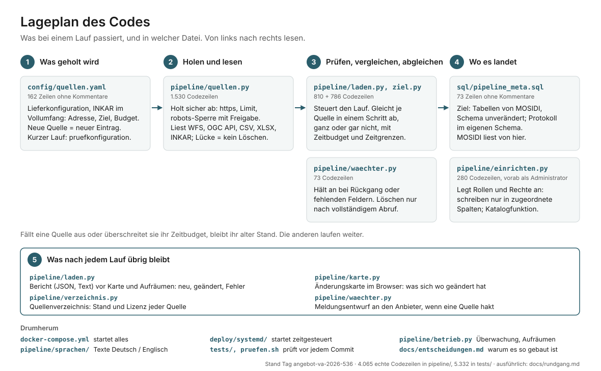

# Geodaten-Import-Pipeline

English: [README.en.md](README.en.md)

Holt Geodaten aus WFS-Diensten, CSV-Tabellen, Statistischen Berichten (XLSX) und der INKAR-Gesamtdatei automatisch in PostgreSQL/PostGIS (EPSG:4326), mit Bericht je Lauf. Der Prototyp verarbeitet die dokumentierten Beispielkonfigurationen. Jede Quelle läuft in einer eigenen Transaktion; gelöscht wird nur nach belegt vollständigem Abruf, eine Nullmenge oder ein starker Rückgang hält die Quelle an. Wie weit das trägt, sagen die Tests und die Grenzen in [`docs/entscheidungen.md`](docs/entscheidungen.md); den Katalog (`source_granularities`) aktualisiert die Pipeline nach den Quellen in eigener Transaktion selbst, die Prüfung geerbter Datenbankrechte (PUBLIC, Standardrechte) ist ein gesonderter Betriebsschritt.

Prototyp der Stiebitz Souverain Systems UG zur Ausschreibung VA-2026-536 der TH Brandenburg. Stand: Abgabestand (Tag `angebot-va-2026-536`) ist der Stand nach E51 vom 07.11.2026 (Prüfbericht vom 07.11., 03:13: Zeitgrenzen der Datenbank je Quelle, erlaubte Fußzeilen nach dem Datenbereich, WFS-Kennung aus `gml:id`, INKAR im Vollumfang als Lieferkonfiguration, Prüfwerkzeuge in fester Version). Er baut auf dem Stand nach E50 vom 06.11.2026 einschließlich der Nachprüfung auf (Prüfbericht vom 06.11., 13:26: INKAR automatisch per URL mit benannter Freigabe, INKAR-Zeilen syntaktisch geprüft, Pflichtbericht vor optionalen Ausgaben, Zeitbudget je Quelle, bestätigte Leerlieferung, die in E49 benannten Codefehler behoben). Tests, Läufe gegen die echten Dienste, der Lauf im Compose von MOSIDI und die Lieferkonfiguration im Vollumfang (Erst- und Folgelauf, mit Wertabgleich je Zeile) liegen am Stand nach E51 vor (Prüfstand `beispielberichte/pruefstand-2026-11-07-e51/`); die Prüfstände nach E50 und E49 mit ihren Belegen sind abgelöst (`beispielberichte/pruefstand-2026-11-06-e50/`, `beispielberichte/pruefstand-2026-11-06-e49/`). Schreibt in die Bestandstabellen der Plattform MOSIDI (Schema aus dem öffentlichen Repository MOSIDI-ORG/MOSIDI), ohne deren Schema zu verändern. Mit KI-Unterstützung geschrieben, von uns geprüft und betrieben.

> **Stand nach E51 vom 07.11.2026** ([`docs/entscheidungen.md`](docs/entscheidungen.md), E51): **Zeitgrenzen der Datenbank je Quelle:** `statement_timeout` (Rest des Zeitbudgets) und `lock_timeout` (höchstens `db_sperre_max_s`, Standard 300 s) je Transaktion einer Quelle; ist die Zieltabelle von einer anderen Sitzung gesperrt, wird nur diese Quelle zurückgerollt („Zeitbudget/Datenbank-Zeitgrenze“), die nächste läuft. **Fußzeilen:** Nach dem Datenbereich einer CSV-Statistiktabelle sind nur eindeutig erkennbare Fußzeilen erlaubt (Standard streng, je Quelle `fuss_muster`); eine beschädigte letzte Datenzeile sperrt das Löschen, ebenso zweifelhafte Restzeilen in XLSX und INKAR. **WFS-Kennung** wahlweise aus `gml:id` (`id_feld: "@gml:id"`). **INKAR im Vollumfang** ist die Lieferkonfiguration `config/quellen.yaml` (alle Indikatoren aller Gemeinden Deutschlands, Antwort 33; `zeitbudget_min: 240`, `TimeoutStartSec=7h`); die bisherige reduzierte Fassung ist die Prüfkonfiguration `config/pruefkonfiguration.yaml`. **Prüfwerkzeuge** in fester Version. **Nachprüfung zu E51:** Abbruch durch `statement_timeout` am aufgebrauchten Budget erkannt statt am Text der Servermeldung (der der Locale des Servers folgt), Obergrenze von `zeitbudget_min` und `db_sperre_max_s` vor dem Lauf geprüft, `fuss_muster` erlaubt auch eine Fußnote, die mit einer Jahreszahl beginnt, Testlücken zu den Zeitgrenzen und Fußzeilen geschlossen; offen benannt: Die Pipeline schreibt die INKAR-Kennziffer achtstellig, der Import der TH bei 77 % der Zeilen im Vollumfang siebenstellig (Klärung aus E28 vor dem Regelbetrieb). **Tests:** `pruefen.sh` ohne Befund, 424 Tests; Datenbanktests auf PostgreSQL 16.15 und 18.6 je 70 von 70 (zusammen 494, einschließlich der Nachprüfung zu E51). Läufe gegen die echten Dienste am selben Stand (erste Zeile der Tabelle, Prüfstand `beispielberichte/pruefstand-2026-11-07-e51/`): Lieferkonfiguration im Vollumfang mit Erst- und Folgelauf unter dem Zeitbudget, Wertabgleich aller 33 547 606 INKAR-Zeilen 0/0/0, Prüfkonfiguration, Deutschland und Compose von MOSIDI mit denselben Zählungen wie nach E50.
>
> **Stand nach E50 vom 06.11.2026, Grundlage von E51** ([`docs/entscheidungen.md`](docs/entscheidungen.md), E50): **INKAR automatisch per URL** (Antwort 33): `www.bbr-server.de` sperrt automatische Abrufe per robots.txt; die ausgelieferte Konfiguration trägt eine benannte Freigabe (`robots_freigabe`: Vorgabe des Auftraggebers, Erlaubnis des BBSR in AP 1), die nur für diesen Rechner und diese Quelle gilt und in Bericht, Protokoll und `--ziele` steht; die abgelegte Datei bleibt als zusätzlicher Weg für Prüfläufe. Wir selbst rufen den Rechner nicht ab (Tests mit Attrappen). **INKAR-Zeilen** werden mit dem CSV-Parser vor jedem Filter geprüft; nicht deutbare Zeilen der eigenen Raumebene sperren das Löschen (am echten Bestand 2025: 62 929 bzw. 1 640 420 Datensätze wie nach E49, keine Warnung). **Pflichtbericht** zuerst, Karte und Aufräumen danach mit eigenem Fehlerpfad; jeder Abbruchbericht enthält die bis dahin bearbeiteten Quellen. **Doppelte WFS-IDs** mit abweichendem Inhalt sperren das Löschen. **Zeitbudget je Quelle** (Standard 30 min, Transaktion zurückgerollt). **Bestätigte Leerlieferung** nur mit `--leerlieferung` für einen Lauf. Die in E49 benannten Codefehler sind behoben. Nachprüfung zu E50 am selben Tag: über mehrere Zeilen zusammengezogene INKAR-Datensätze sperren das Löschen, Freigabe und Folge-Links nach dem Rechner, den requests anwählt, Abbruchbericht mit dem Protokoll der abgebrochenen Quelle, abgelöste Belegskripte brechen ab. **Tests:** `pruefen.sh` ohne Befund, 386 Tests; Datenbanktests auf PostgreSQL 16.15 und 18.6 je 66 von 66 (zusammen 452); **Läufe am selben Stand** (06./07.11.2026, `beispielberichte/pruefstand-2026-11-06-e50/`): Brandenburg, Deutschland und Compose von MOSIDI mit denselben Zählungen wie nach E49, alle Rückgabe 0; INKAR aus der abgelegten Datei, die Vorrang vor der Freigabe hat, `www.bbr-server.de` nicht abgerufen; der Abruf per URL ist nur mit Attrappen getestet. **INKAR-Vollumfang** (Befund W1): alle 355 Reihen aller 10 978 Gemeinden Deutschlands, wie der Import der TH, 33 547 606 Zeilen, gleich der Zählung aus der Datei. Belege: [`docs/entscheidungen.md`](docs/entscheidungen.md) (E50), [`docs/betrieb.md`](docs/betrieb.md) (Quellen und Abrufregeln).
>
> **Zur Prüfung im Vergabeverfahren VA-2026-536:** Die Zahlen aus dem Angebot stehen in diesen Laufberichten. Die erste Zeile ist der Abgabestand (Tag `angebot-va-2026-536`, Stand nach E51) mit seinen Tests und Läufen (gegen die echten Dienste, im Compose von MOSIDI, Lieferkonfiguration im Vollumfang), alle am selben Stand. Die zweite Zeile ist der abgelöste Stand nach E50 mit seinen Läufen. Die dritte Zeile ist der abgelöste Stand nach E49 mit seinen Läufen, die vierte beschreibt die Änderung E48; die fünfte und sechste sind der abgelöste Stand nach E47 mit seinen Läufen, die siebte der abgelöste Stand nach E46.
>
> | Angabe im Angebot | Beleg |
> |---|---|
> | **Abgabestand (Tag `angebot-va-2026-536`): Stand nach E51 vom 07.11.2026** ([`docs/entscheidungen.md`](docs/entscheidungen.md), E51): Zeitgrenzen der Datenbank je Quelle (K1), erlaubte Fußzeilen und zweifelhafte Restzeilen in CSV, XLSX und INKAR (K2), WFS-Kennung aus `gml:id` (W3), INKAR im Vollumfang als Lieferkonfiguration mit `zeitbudget_min: 240` und `TimeoutStartSec=7h`, reduzierte Fassung als Prüfkonfiguration `config/pruefkonfiguration.yaml` (W2), Prüfwerkzeuge in fester Version (G2); je Punkt ein Test, rot am Stand nach E50. **Tests:** `pruefen.sh` ohne Befund, 424 Tests; Datenbanktests auf PostgreSQL 16.15 und 18.6 je 70 von 70 (zusammen 494, einschließlich der Nachprüfung zu E51). **Läufe am selben Stand** (07.11.2026, Teilbäume in den Protokollen und in `ablauf.txt`; robots.txt je abgerufenem Rechner vorher geprüft; `www.bbr-server.de` und `www.regionalstatistik.de` nicht abgerufen, INKAR aus der abgelegten Datei; Pipeline im Container mit 1 GiB, frische Datenbank PostgreSQL 16.15): **Lieferkonfiguration `config/quellen.yaml` im Vollumfang** Rückgabe 0: Erstlauf 129,7 min mit 33 547 606 INKAR-Zeilen (355 Indikatornamen, 10 978 Gemeinden, 1995 bis 2024) und den Brandenburger Quellen, Folgelauf 159,7 min alles unverändert, dritter Lauf nichts fällig; INKAR höchstens 158,2 min gegen `zeitbudget_min: 240`, kein Budgetabbruch; höchste Probe von `docker stats` 122,6 MiB, `memory.peak` bis 457,5 MiB; Datenbank danach 24 GB, während der Läufe mindestens 66 GB; Rechner zeitweise stark belastet (1-Minuten-Last bis 32). **Wertabgleich je Zeile** (eigenes Skript ohne Code der Pipeline): alle 33 547 606 Zeilen der Quelle mit gleichem Schlüssel und gleichem Wert in `dashboard_data_de`, 0 fehlend, 0 überzählig, 0 abweichend. **Prüfkonfiguration** (Brandenburg, bis E50 `config/quellen.yaml`): 882 Gebäude, 413 Gemeinden, 18 Kreise, 413 + 413 Werte des Amts für Statistik, 62 929 INKAR-Werte in 146,8 s. **Deutschland** (`config/deutschland.yaml`): 11 103 Gemeindeflächen, 1 640 420 INKAR-Werte, 325,6 s, Folgelauf 290,2 s unverändert. **Compose von MOSIDI** (Commit `26cadbb`, Prüfkonfiguration): Rückgabe 0 und 0, Katalog 0 → 11 Zeilen, Schema `public` unverändert. Alle Zählungen wie nach E50, 0 doppelte Zielschlüssel, keine Warnung | [`docs/entscheidungen.md`](docs/entscheidungen.md) (E51), [`config/quellen.yaml`](config/quellen.yaml), [`config/pruefkonfiguration.yaml`](config/pruefkonfiguration.yaml), [Prüfstand am Abgabestand](beispielberichte/pruefstand-2026-11-07-e51/), [Wertabgleich](beispielberichte/pruefstand-2026-11-07-e51/wertabgleich/ergebnis-vollumfang.txt), [`pruefen.log`](beispielberichte/pruefstand-2026-11-07-e51/pruefen.log), [`datenbanktests.log`](beispielberichte/pruefstand-2026-11-07-e51/datenbanktests.log) |
> | **Stand nach E50 vom 06.11.2026 einschließlich der Nachprüfung (als Abgabestand abgelöst durch E51, erste Zeile), Belege an jenem Stand** ([`docs/entscheidungen.md`](docs/entscheidungen.md), E50): INKAR per URL mit benannter Freigabe (`robots_freigabe`, in Bericht, Protokoll und `--ziele`; Erlaubnis des BBSR in AP 1), INKAR-Zeilen vor jedem Filter geprüft, Pflichtbericht zuerst, Zeitbudget je Quelle, bestätigte Leerlieferung, die in E49 benannten Codefehler behoben. **Tests:** `pruefen.sh` ohne Befund, 386 Tests; Datenbanktests auf PostgreSQL 16.15 und 18.6 je 66 von 66 (zusammen 452). **Läufe gegen die echten Dienste am selben Stand** (06./07.11.2026, Teilbäume in den Protokollen und in `ablauf.txt`; robots.txt jedes abgerufenen Rechners vorher geprüft, Tabelle im README des Prüfstands; `www.bbr-server.de` und `www.regionalstatistik.de` nicht abgerufen, auch nicht ihre robots.txt; INKAR aus der abgelegten Datei, die Vorrang vor der Freigabe hat, belegt durch den Hinweis „robots_freigabe konfiguriert, nicht genutzt“, leere `letzte_abfrage` und die Namensauflösung `0.0.0.0` im Container). Der Abruf per URL ist nur mit Attrappen getestet. Pipeline im Container (Grenze 1 GiB), frische Datenbank (PostgreSQL 16.15, PostGIS 3.6.4) mit dem Schema von MOSIDI. **Brandenburg** (`config/quellen.yaml` jenes Stands, seit E51 `config/pruefkonfiguration.yaml`): 882 Gebäude, 413 Gemeinden, 18 Kreise; 413 + 413 Werte des Amts für Statistik und 62 929 INKAR-Werte (9 Indikatornamen) in `dashboard_data_de`; `table_metadata` 14 Zeilen; Flächenprüfung höchstens 0,398 %; `aktualit` 882 Werte umgewandelt. Erstlauf 145,0 s, Folgelauf 144,2 s alles unverändert, dritter Lauf 0,03 s alle Quellen „nicht fällig“; Rückgabe 0, keine Warnung. **Deutschland** (`config/deutschland.yaml`): 11 103 Gemeindeflächen und 1 640 420 INKAR-Werte, Erstlauf 334,9 s, Folgelauf 306,6 s, Rückgabe 0, Datenbank 1 132 MB. In beiden 0 Zeilen verworfen, zurückgehalten oder zusammengeführt, 0 doppelte Zielschlüssel, Datenbankauszüge in den Zählungen zeilengleich mit E49. Der INKAR-Schritt dauert länger als nach E49 (Brandenburg 126,5 statt 95,1 s; Deutschland 284,8 statt 244,2 s), etwa zur Hälfte durch das vollständige Lesen der Datei seit K1 (Messung des Adapters allein, README des Prüfstands). **Speicher:** höchste Probe von `docker stats` bis 134,0 MiB (Brandenburg) und 96,2 MiB (Deutschland); `memory.peak` einschließlich Seitencache bis 581 MiB bzw. 336 MiB. **Compose von MOSIDI** (frisch geklont, Commit 26cadbb): `pipeline-einrichten` und zwei Läufe `--alle` gegen `brandenburg_db` (PostgreSQL 18.6) mit denselben Zählungen in 145,6 und 142,4 s, Rückgabe 0; `source_granularities` 0 → 11 Zeilen, `public` vorher und nachher gleich. **INKAR-Vollumfang** (Befund W1, Antwort 33: Umfang nach `inkar_import`): Der Import der TH nimmt alle Indikatoren aller Gemeinden Deutschlands (`config.xml` nennt nur Spalten, `inkar_db_import.py` wählt nur den Raumbezug Gemeinden). Mit einer Prüfkonfiguration im Prüfstand (`indikatoren: alle`, ganz Deutschland): 33 547 606 Zeilen, 355 Indikatornamen, 10 978 Gemeinden, Zeitbezug 1995 bis 2024, je Name gleich der Zählung direkt aus der Datei; Rückgabe 0, keine Warnung, 0 doppelte Zielschlüssel; 146,5 min, höchste Probe 37,1 MiB, `memory.peak` 189,4 MiB, Datenbank danach 25 GB. Zu Projektbeginn anzupassen (Soll-/Ist-Tabelle im README des Prüfstands): Zeitbudget (damals 90 min) und Abbruch nach 2 h reichten für den vollen Umfang nicht, und die Lieferkonfiguration lud 5 Kürzel (seit E51 behoben: Vollumfang als Lieferkonfiguration, 240 min, 7 h); `dashboard_data_metadata` (Blatt ZOM) schreibt die Pipeline nicht; landesweite WFS-Objektarten über die Verwaltungsgrenzen hinaus sind nicht gelaufen | [`beispielberichte/pruefstand-2026-11-06-e50/`](beispielberichte/pruefstand-2026-11-06-e50/) (Tests, Läufe, Compose von MOSIDI, INKAR-Vollumfang mit Soll-/Ist-Tabelle, robots.txt, Teilbäume), [`docs/entscheidungen.md`](docs/entscheidungen.md) (E50) |
> | **Stand nach E49 vom 06.11.2026 (als Abgabestand abgelöst durch E50, erste Zeile), Belege an jenem Stand** ([`docs/entscheidungen.md`](docs/entscheidungen.md), E49): Am Code der Stand nach E48 (dritte Zeile) bis auf die Namensnennung von basemap.de in `pipeline/karte.py` (Attributionstext; im `nur-kommentare.log` als „AUSSERHALB E49“ geführt); E49 ergänzt nur Kommentare und Docstrings, maschinell belegt (`nur-kommentare.py`, jede Datei OK oder BEABSICHTIGT). **Tests:** `pruefen.sh` ohne Befund, 264 Tests; Datenbanktests auf PostgreSQL 16.15 und 18.6 je 63 von 63. **Läufe gegen die echten Dienste am selben Stand** (06.11.2026, Teilbäume in den Protokollen und in `ablauf.txt`; robots.txt jedes abgerufenen Rechners vorher geprüft, Tabelle im README des Prüfstands; `www.bbr-server.de` und `www.regionalstatistik.de` nicht abgerufen, INKAR aus der abgelegten Datei). Pipeline im Container (Grenze 1 GiB), frische Datenbank (PostgreSQL 16.15, PostGIS 3.6.4) mit dem Schema von MOSIDI (Antworten 26, 27, 47). **Brandenburg** (`config/quellen.yaml`): 882 Gebäude in `"Gebäude (ALKIS)"`, 413 Gemeinden in `"Kommunale Gebiete Brandenburg (InNoWest)"`, 18 Kreise in `"Landkreis"`; 413 Bevölkerungs- und 413 Flächenwerte des Amts für Statistik (Bevölkerung 31.12.2025, Fläche 31.12.2024) und 62 929 INKAR-Werte (9 Indikatornamen, Zeitbezug 1995 bis 2023) in `dashboard_data_de`, getrennt über `source`, `data_type = indikator`; `table_metadata` nach DCAT-AP 14 Zeilen; 413 von 413 Gebietsschlüsseln mit Fläche (`nationalco` = AGS ist eine Annahme des Prototyps, Abgleich in AP 1); Flächenprüfung höchstens 0,398 % (Toleranz 0,5 %); `aktualit`: 882 Werte als Datum ohne Zeitzonenkennung Z übernommen (E47). Erstlauf 112,9 s, Folgelauf 113,7 s alles unverändert, dritter Lauf 0,02 s mit allen Quellen „nicht fällig“ nach Rhythmus je Quelle; Rückgabe 0 in allen drei Läufen, keine Warnung. **Deutschland** (`config/deutschland.yaml`, nur andere Konfiguration, Antwort 32): 11 103 Gemeindeflächen (VG250 des BKG) und 1 640 420 INKAR-Werte, Erstlauf 294,4 s, Folgelauf 262,8 s ohne eine Änderung, Rückgabe 0, Datenbank 1 132 MB; dieselben Zählungen wie nach E47. In beiden 0 Zeilen verworfen, zurückgehalten oder zusammengeführt, 0 doppelte Zielschlüssel. **Laufzeiten:** eine Reihe auf einem parallel genutzten Entwicklungsrechner (16 Kerne, 1-Minuten-Last 1,6 bis 4,5, je Lauf in `ablauf.txt`), Größenordnungen. **Speicher:** höchste Probe von `docker stats` bis 135,1 MiB (Brandenburg) und 94,4 MiB (Deutschland); `memory.peak` der cgroup einschließlich Seitencache bis 586 MiB bzw. 99 MiB. **Compose von MOSIDI** (MOSIDI frisch geklont, Commit 26cadbb): `pipeline-einrichten` und zwei Läufe `--alle` gegen `brandenburg_db` (PostgreSQL 18.6) mit denselben Zählungen in 111,9 und 114,4 s, Rückgabe 0; die Materialized View `source_granularities` in der Fassung von MOSIDI aktualisiert (0 → 11 Zeilen: 9 INKAR, 2 Amt für Statistik), `public` vorher und nachher gleich | [`beispielberichte/pruefstand-2026-11-06-e49/`](beispielberichte/pruefstand-2026-11-06-e49/) (Tests, Läufe, Compose von MOSIDI, robots.txt, Teilbäume, `nur-kommentare`), [`docs/entscheidungen.md`](docs/entscheidungen.md) (E49) |
> | **Stand nach E48 vom 06.11.2026 (Code des Stands nach E49, zweite Zeile; E49 ergänzt nur Kommentare), Statistik des Amts für Statistik als XLSX, robots.txt je Rechner** ([`docs/entscheidungen.md`](docs/entscheidungen.md), E48): Die Regionaldatenbank (`www.regionalstatistik.de`) sperrt automatische Abrufe per robots.txt (`Disallow: /`) und wird nicht mehr abgerufen. Bevölkerung und Gebietsfläche je Gemeinde kommen aus dem Statistischen Bericht A I 4 / A V 2 des Amts für Statistik Berlin-Brandenburg (XLSX, neuer Typ `xlsx`, Lizenz CC BY 3.0 DE): Bevölkerung insgesamt am 31.12.2025, Fläche Stand 31.12.2024 (Fußnote des Berichts); „männlich“ und „weiblich“ entfallen. Statt 1 239 + 413 Werten sind 413 + 413 zu erwarten; an der Datei des Amts ohne Datenbank nachgerechnet: 413 Gemeinden, 2 551 889 Einwohner (gleich der Landeszeile), 29 654,42 km². INKAR: `www.bbr-server.de` sperrt per robots.txt ebenfalls (`Disallow: /`); die Belegläufe bis E47 haben INKAR dort abgerufen (Fundstelle `letzte_abfrage` in `beispielberichte/pruefstand-2026-11-05-e47/`). Seit der Prüfung nach E48 ruft die Pipeline per robots.txt gesperrte Pfade nie ab (Sperrliste im Code, auch `--ziele`); INKAR lädt nur aus einer abgelegten Datei, sonst bricht die Quelle ohne Abruf ab; Klärung mit TH und BBSR offen. (Abgelöst durch E50: INKAR per URL mit `robots_freigabe`, gesperrte Pfade sonst weiter nie.) Die Läufe der folgenden Zeilen stammen vom Stand nach E47; ihre Zahlen zur Statistik stammen aus der Regionaldatenbank. Die Läufe am Code dieses Stands sind am Stand nach E49 nachgeholt (zweite Zeile). **Tests am Stand nach E48 und Prüfung:** `pruefen.sh` ohne Befund, 264 Tests; Datenbanktests auf PostgreSQL 16.15 und 18.6 je 63 von 63 (Protokolle mit Teilbäumen in `beispielberichte/pruefstand-2026-11-06-e48/`). | [`beispielberichte/pruefstand-2026-11-06-e48/`](beispielberichte/pruefstand-2026-11-06-e48/) (Tests), [`docs/entscheidungen.md`](docs/entscheidungen.md) (E48), [`docs/betrieb.md`](docs/betrieb.md) (Quellen und Abrufregeln) |
> | **Stand nach E47 vom 05.11.2026 (als Abgabestand abgelöst durch E48 bis E50, erste bis dritte Zeile; Läufe gegen die echten Dienste an diesem Stand in der nächsten Zeile)** (Prüfbericht vom 05.11. abends, Befunde 1, 2, 3, 6, 11, und Nachprüfung; [`docs/entscheidungen.md`](docs/entscheidungen.md), E47): Eine Datenzeile einer Statistiktabelle, die der Gebietsfilter (`zeilen_muster`) übergeht, weil ihr Schlüssel fehlt, Buchstaben, Leerzeichen, Tab oder Anführungszeichen enthält, macht den Abruf unvollständig und sperrt das Löschen; ein Schlüssel, der nach einem Schaden nur aus Ziffern besteht (fehlende oder doppelte Ziffer), fällt nicht auf. Eine WFS-Kachel ohne Gesamtzahl gilt erst mit Beleg als vollständig (`CountDefault` des Dienstes, leere Folgeseite mit so vielen verschiedenen Objekten wie gezählt, oder bei WFS 1.1.0 Trefferzahl), sonst als unvollständig; ein Dienst, der nicht blättert, belegt Vollständigkeit nur mit Gesamtzahl oder `CountDefault`. Kein Text wird mehr gekürzt: Ein Datum `JJJJ-MM-TTZ` wird ohne die Zeitzonenkennung übernommen (`aktualit` der ALKIS-Gebäude), jede andere zu lange Angabe hält ihre Zeile zurück. OGC API Features: Ein schon abgerufener Folge-Link oder eine Seite ohne neues Objekt beendet den Abruf als unvollständig. Hat eine vorhandene Import- oder Leserolle weitere Rechte oder gehören ihr Objekte der Datenbank, bricht `einrichten` ab, bevor es etwas ändert. **Tests am Stand nach E47:** `pruefen.sh` ohne Befund, 190 Tests; Datenbanktests auf PostgreSQL 16.15 und 18.6 je 59 von 59. **Tests, Läufe gegen die echten Dienste (nächste Zeile) und Lauf im Compose von MOSIDI am selben Stand, 05./06.11.2026** | [`beispielberichte/pruefstand-2026-11-05-e47/`](beispielberichte/pruefstand-2026-11-05-e47/) (Tests, Läufe, Compose von MOSIDI, Teilbäume), [`docs/entscheidungen.md`](docs/entscheidungen.md) (E47) |
> | **Läufe gegen die echten Dienste: Prüfstand am Stand nach E47 vom 05./06.11.2026, Tests und Läufe am selben Stand (abgelöst durch die Läufe nach E49, nach E50 und am Abgabestand nach E51, dritte, zweite und erste Zeile)** (Teilbäume in den Protokollen und in `ablauf.txt`). Pipeline im Container (Grenze 1 GiB), frische Datenbank (PostgreSQL 16.15, PostGIS 3.6.4) mit dem Schema von MOSIDI (Antworten 26, 27, 47). **Brandenburg** (`config/quellen.yaml`): 882 Gebäude in `"Gebäude (ALKIS)"`, 413 Gemeinden in `"Kommunale Gebiete Brandenburg (InNoWest)"`, 18 Kreise in `"Landkreis"`; 1 239 Bevölkerungs- und 413 Flächenwerte (damals aus der Regionaldatenbank) und 62 929 INKAR-Werte (9 Indikatornamen, Zeitbezug 1995 bis 2023) in `dashboard_data_de`, getrennt über `source`, `data_type = indikator`; `table_metadata` nach DCAT-AP 16 Zeilen; 413 von 413 Gebietsschlüsseln mit Fläche (`nationalco` = AGS ist eine Annahme des Prototyps, Abgleich in AP 1); Flächenprüfung höchstens 0,161 % (gerundet 0,16 %). Erstlauf 115,3 s, Folgelauf 111,8 s alles unverändert, dritter Lauf 4,8 s mit fünf Quellen „nicht fällig“ nach Rhythmus je Quelle. **Rückgabe 1 in allen drei Läufen, Befund am Dateiaufbau:** Zeile 7 der Flächentabelle der Regionaldatenbank (direkt nach dem konfigurierten Kopfende) hat keinen gültigen Gebietsschlüssel; die Datenbereichsprüfung (E47) meldet die Quelle als unvollständig, die 413 Flächen werden geladen, nichts wird gelöscht, die Quelle wird bei jedem Lauf erneut geholt; der Inhalt der Zeile ist nicht gesichtet, Behebung nach Sichtung über das Kopfende in der Konfiguration (README des Prüfstands). `aktualit`: 882 Werte als Datum ohne Zeitzonenkennung Z übernommen (E47), keine Kürzung mehr. **Deutschland** (`config/deutschland.yaml`, nur andere Konfiguration, Antwort 32): 11 103 Gemeindeflächen (VG250 des BKG) und 1 640 420 INKAR-Werte, Erstlauf 303,6 s, Folgelauf 259,6 s ohne eine Änderung, Rückgabe 0, Datenbank 1 132 MB. In beiden 0 Zeilen verworfen, zurückgehalten oder zusammengeführt, 0 doppelte Zielschlüssel, dieselben Zählungen wie nach E45 und E46. **Laufzeiten:** eine Reihe auf einem parallel genutzten Entwicklungsrechner (16 Kerne, 1-Minuten-Last 1,6 bis 3,7, je Lauf in `ablauf.txt`), Größenordnungen; die INKAR-Datei kam aus dem Zwischenspeicher (je Lauf beim BBSR-Server per URL auf Änderung abgefragt). Nach E46 lagen sie bei 112,6 und 112,3 s (Brandenburg) bzw. 272,6 und 260,4 s (Deutschland), nach E45 in zwei Reihen bei höherer Last bei 118,6 bis 198,1 s und 259,9 bis 432,7 s. **Speicher:** höchste Probe von `docker stats` bis 119,0 MiB (Brandenburg) und 94,3 MiB (Deutschland); `memory.peak` der cgroup einschließlich Seitencache bis 599 MiB bzw. 98 MiB (der Ausreißer nach E46, 365,9 MiB, trat nicht wieder auf; Ursache nicht belegt). **Compose von MOSIDI** (Wiederholung der Läufe vom 03. und 05.11.): `pipeline-einrichten` und zwei Läufe `--alle` gegen `brandenburg_db` (PostgreSQL 18.6) mit denselben Zählungen in 112,3 s, die Materialized View `source_granularities` in der Fassung von MOSIDI aktualisiert (0 → 13 Zeilen), `public` vorher und nachher gleich; Rückgabe 1 wegen der Flächentabelle | [`beispielberichte/pruefstand-2026-11-05-e47/`](beispielberichte/pruefstand-2026-11-05-e47/) (Läufe, Compose von MOSIDI, Tests, Teilbäume) |
> | **Stand nach E46 vom 05.11.2026, abgelöst durch den Stand nach E47 (fünfte Zeile) und die Stände nach E50 und E51 (zweite und erste Zeile)** (Prüfbericht vom 05.11., Befunde F2 bis F5, F10, F13; [`docs/entscheidungen.md`](docs/entscheidungen.md), E46): Nach jedem Lauf mit Änderungen aktualisiert die Pipeline auch die Materialized View `source_granularities` des Katalogs (Antwort 75) über eine Funktion, die `einrichten` als Administrator anlegt und die nur die Importrolle ausführen darf; fehlt die View, steht ein Hinweis im Bericht. Ist ein Name in `table_metadata` schon für eine andere Quelle oder Raumebene belegt, hält die Quelle vor dem Schreiben an, statt Fachdaten ohne Metadatensatz zu laden. Schon vorhandene Zeilen zählen bei der Übernahme fachlich als geändert oder unverändert (Antwort 62), die Übernahme steht zusätzlich im Bericht. Reparatur, Transformation und Zieltyp der Geometrie je Objekt. WFS ohne Gesamtzahl blättert bis zur leeren Seite. Sperre auch datenbankweit; `einrichten` setzt die Schreibrechte auf den Sollstand. **Tests am Stand nach E46:** `pruefen.sh` ohne Befund, 168 Tests; Datenbanktests auf PostgreSQL 16.15 und 18.6 je 47 von 47 (mit der Nachprüfung zu E46: gescheiterte Katalogaktualisierung wird nachgeholt, `einrichten` meldet fremd vergebene Rechte statt abzubrechen und prüft den Eigentümer der Katalogfunktion). Tests, Läufe gegen die echten Dienste und Lauf im Compose von MOSIDI an jenem Stand (Brandenburg 112,6 und 112,3 s, Deutschland 272,6 und 260,4 s, dort noch mit Kürzung von `aktualit`); die Zahlen gelten nur für jenen Stand | [`beispielberichte/pruefstand-2026-11-05-e46/`](beispielberichte/pruefstand-2026-11-05-e46/) (abgelöst) |
> | **Schlüssel und Schutz (E40 bis E42):** Der INKAR-Schlüssel aus Kennziffer, Bereich, Kürzel, Indikator, Zeitbezug (Antworten 31, 62) steht je Zeile im Register `pipeline_meta.bestand` (eigenes Schema, Antwort 29) und bestimmt die Zählung neu, geändert, gelöscht. Abbildung auf das unveränderte `dashboard_data_de` (Antworten 27, 29) über eine feste Regel aus dem Schlüssel der Zeile, nie aus Messwerten: Langtext, außerhalb des Bereichs ZOM mit dem Bereich in Klammern, z. B. „Einwohnerdichte (LRB)“. Damit tragen alle Reihen außerhalb von ZOM den Bereich im Namen, auch bei eindeutigem Langtext (in Brandenburg 5 der 9 Namen); Abstimmung mit der TH in AP 1. Ergeben zwei Quellschlüssel denselben Zielnamen, hält die Quelle an, geprüft über alle Zeilen, bevor leere Werte oder Pflichtfelder gefiltert werden; nichts wird zusammengeführt oder verworfen. Ein umbenanntes Kürzel zählt als gelöscht und neu (Antwort 62). Gesamtanalyse INKAR 2025: 355 Reihen, 355 Namen; Brandenburg mit allen 264 Kürzeln 35 819 doppelte Kurzschlüssel, davon 826 mit verschiedenem Wert; nach der Regel 0. Gelöscht wird nur nach vollständigem, fehlerfreiem Abruf und nur bei Attributen, Raumdaten nie (Antwort 74). Zeilen ohne Pflichtwert und leere CSV-Zeilen werden mit Warnung ausgelassen, der bisherige Wert bleibt, auch wenn der Stichtag vorrückt. Ein unvollständiger Abruf übernimmt Neues und Geändertes, löscht nichts, endet mit Rückgabe 1 und gilt nicht als Erfolg (Quellenverzeichnis, `pipeline_meta`, `--status`). Unlesbare Geometrien (WKT, GML, GeoJSON) werden je Objekt ausgelassen. Abgefangene Fehler erzeugen bei beschreibbarem Berichtsordner einen Abbruchbericht (Rückgabe 2), ausbleibende Berichte und harte Abbrüche erkennt die Überwachung (`--status`). Berichte werden atomar geschrieben; das URL-Schema wird vor jeder Verbindung geprüft (https Standard) | [`docs/entscheidungen.md`](docs/entscheidungen.md) (E40 bis E42), [`beispielberichte/inkar-schluessel/`](beispielberichte/inkar-schluessel/) |
> | Grenzfall Kachelgrenzen: Der LGB-Dienst liefert in 9 Kacheln 940 Objekte für 882 Gebäude, 53 davon in mehreren Kacheln; übernommen wird jedes genau einmal. Nachgezählt am 05.11. mit gespeicherter Prüfausgabe (Zeitpunkt, Kachel-BBOX je Abfrage) | [`beispielberichte/kachelgrenzen/`](beispielberichte/kachelgrenzen/), [Prüfausgabe](beispielberichte/kachelgrenzen/pruefausgabe-2026-11-05.txt) |
> | WFS 1.1.0 neben 2.0.0 (Antwort 67): Kreise der LGB über beide Versionen, 18 von 18, gleiche IDs, Sachdaten und Koordinaten; Prüfausgabe vom 05.11. mit Zeitpunkt und Abfragen | [`beispielberichte/wfs-1.1.0/`](beispielberichte/wfs-1.1.0/), [Prüfausgabe](beispielberichte/wfs-1.1.0/pruefausgabe-2026-11-05.txt) |
> | Compose von MOSIDI: erster Lauf am 03.11., vor der Schlüsselumstellung E40, nach E46 (Rückgabe 0), E47 (Rückgabe 1 wegen der Flächentabelle) und E49 (Rückgabe 0) wiederholt am Stand nach E50 (zweite Zeile; Rückgabe 0) und am Abgabestand nach E51 (erste Zeile; Rückgabe 0, mit der Prüfkonfiguration): als zusätzlicher Dienst im Compose von MOSIDI gegen `brandenburg_db` (PostgreSQL 18.6, PostGIS 3.6.4), Protokoll im eigenen Schema `pipeline_meta`. Befund: Das unveränderte `brandenburg_db` startet mit dem Image `postgis/postgis` (PostgreSQL 18) auf einem neuen Volume nicht (Einhängepunkt). Die aktuellen Zahlen stehen in der ersten Zeile | [`deploy/mosidi/`](deploy/mosidi/), [`beispielberichte/mosidi-compose/`](beispielberichte/mosidi-compose/), [Wiederholung am Abgabestand](beispielberichte/pruefstand-2026-11-07-e51/mosidi-compose/), [nach E50](beispielberichte/pruefstand-2026-11-06-e50/mosidi-compose/), [nach E49](beispielberichte/pruefstand-2026-11-06-e49/mosidi-compose/), [nach E47](beispielberichte/pruefstand-2026-11-05-e47/mosidi-compose/) |
> | Rückgang-Schutz (30.10.): 5 statt 48 Kreise, alter Stand bleibt, Meldungsentwurf an das BKG | [`beispielberichte/20261030T074631Z.txt`](beispielberichte/20261030T074631Z.txt), [Meldung](beispielberichte/20261030T074631Z-meldung-kreise_bkg.txt) |
> | Seitenweiser Abruf: 48 Kreise in 5 Seiten zu höchstens 10 | [`beispielberichte/paging/`](beispielberichte/paging/) |
> | Ausgaben auf Englisch (Textbericht und Meldungsentwurf an einen Anbieter) | [`beispielberichte/englisch/`](beispielberichte/englisch/) |
> | Schlüsselanalyse INKAR 2025 (Abfrage und Ergebnis, ZOM-Kurznamen gegen Langtext) | [`beispielberichte/inkar-schluessel/`](beispielberichte/inkar-schluessel/) |
> | Datenbanktests gegen eine echte PostGIS-Datenbank mit den MOSIDI-Tabellen: Abgleich, Bestandsregister (fremde Zeilen und Spalten bleiben), Löschsperre bei unvollständigem Abruf, Rückgang-Schutz, Rollback, Rhythmus, Rollenrechte, unverändertes Schema der Bestandstabellen, Kürzel- und Stichtagwechsel, Katalog, Metadatenkonflikt, Geometrietyp je Objekt, datenbankweite Sperre, Sollstand der Rechte; am Abgabestand nach E51 je 70 von 70, nach E50 je 66 von 66 auf PostgreSQL 16.15 und 18.6 (`postgis/postgis:latest`), nach E49 und E48 je 63 von 63, am Stand nach E47 je 59 von 59, in der CI als Job `datenbank` für beide Versionen eingerichtet | [`tests/test_datenbank.py`](tests/test_datenbank.py), [Protokoll am Abgabestand](beispielberichte/pruefstand-2026-11-07-e51/datenbanktests.log), [nach E50](beispielberichte/pruefstand-2026-11-06-e50/datenbanktests.log), [nach E49](beispielberichte/pruefstand-2026-11-06-e49/datenbanktests.log), [nach E48](beispielberichte/pruefstand-2026-11-06-e48/datenbanktests.log), [Protokoll nach E47](beispielberichte/pruefstand-2026-11-05-e47/datenbanktests.log) |
> | Prüfkette (Tests, Lückenprüfung, Secret-Scan, Stückliste) | [`pruefen.sh`](pruefen.sh), [GitHub Actions](../../actions) |
> | Weitere Änderungen nach den Prüfungen vom 04. und 05.11. (E37 bis E39): Metadaten je Herausgeber; Änderungskarte ohne Verbindung zu Dritten (Leaflet eingebettet mit Lizenztext, Hintergrundkarten nur ausdrücklich, `karte: false` ohne Datei und ohne Kartenabfrage), Werte aus den Quellen können die Seite nicht brechen; Passwörter nur als SCRAM-Hash an den Server; keine Quelldatensätze im Repository (Antwort 69): Veröffentlicht wird nur der Abgabestand als ein einziger Commit, ältere Entwicklungs-Commits gehören nicht dazu (E43) | [`docs/entscheidungen.md`](docs/entscheidungen.md) (E37 bis E39, E43) |
> | Frühe Läufe vom 30.10. bis 02.11. (Stand damals, Zahlen nur für diesen Stand): erster Lauf mit 882 Gebäuden (LGB), 48 Kreisen (BKG) und unerreichbarer Quelle als Fehler in 5,5 s; Änderungslauf mit 224 neuen und 83 gelöschten Gebäuden (die Karte zeigt seit 05.11. erfundene Objekte, Antwort 69); INKAR und OGC API mit 413 Gemeinden in 3 Minuten; Vorstufe vom 02.11. mit eigenen Zwischentabellen und der Gegenprobe der Flächen über alle 413 Gemeinden (bei 389 ohne Abweichung auf 0,01 km²) | [Erster Lauf](beispielberichte/20261030T074334Z.txt), [`aenderungskarte/`](beispielberichte/aenderungskarte/), [`inkar/`](beispielberichte/inkar/20261030T192227Z.txt), [`datenmodell-th/`](beispielberichte/datenmodell-th/) |
> | **Frühere Stände** (abgelöst, Zahlen gelten nur für den jeweiligen Stand): Prüfstände vom 04.11. (97 Tests, Datenbanktests je 19 von 19, INKAR damals 57 259 Werte), nach E38 (111, je 22 von 22, INKAR 57 259), nach E39 (119, je 24 von 24, ohne Läufe gegen die Dienste), nach E40/E41 (128, je 28 von 28, INKAR 62 929), nach E42 (133, je 35 von 35; Läufe gegen die echten Dienste mit denselben Zählungen wie am Stand nach E47) nach E45 (154, je 38 von 38; Läufe in zwei Reihen mit denselben Zählungen) und nach E46 (168, je 47 von 47; Läufe und Compose-Lauf mit denselben Zählungen, dort noch mit Kürzung von `aktualit`, fünfte Zeile); Läufe gegen das Schema von MOSIDI und der Deutschland-Lauf vom 03.11., beide vor E40 (wertgleiche INKAR-Zeilen damals zusammengeführt bzw. übersprungen, Speicher ohne Rohdaten) | [`…-11-04/`](beispielberichte/pruefstand-2026-11-04/), [`…-11-05/`](beispielberichte/pruefstand-2026-11-05/), [`…-e39/`](beispielberichte/pruefstand-2026-11-05-e39/), [`…-e40/`](beispielberichte/pruefstand-2026-11-05-e40/), [`…-e42/`](beispielberichte/pruefstand-2026-11-05-e42/), [`…-e45/`](beispielberichte/pruefstand-2026-11-05-e45/), [`…-e46/`](beispielberichte/pruefstand-2026-11-05-e46/), [`mosidi-schema/`](beispielberichte/mosidi-schema/), [`deutschland/`](beispielberichte/deutschland/) |

## Was sie leistet

- **Ein Befehl, manuell oder zeitgesteuert:** Ein Befehl lädt alle aktiven Quellen der Konfiguration. Neue Quellen der vorhandenen Typen (WFS, CSV, XLSX, OGC API Features, GeoJSON, INKAR) sind ein Eintrag in `config/quellen.yaml`, kein Code (beim WFS die Objekt-ID aus einem Kindelement oder aus `gml:id` des Features, E51; abweichende fachliche Schlüssel oder Metadatenstrukturen können eine Anpassung im Adapter brauchen); dazu einmal `einrichten` als Administrator, damit die Importrolle Rechte auf die neuen Spalten bekommt, dann ein Probelauf.
- **Nachvollziehbar:** Jeder Lauf schreibt einen Bericht: je Quelle neu, geändert, gelöscht, unverändert, mit Warnungen und Ursachen; dasselbe als Protokoll je Lauf und je Änderung im eigenen Schema `pipeline_meta` (Antworten 30 und 51).
- **Robust gegen die Quellen selbst:** Fällt eine Quelle aus, bricht sie ein oder fehlen ihr konfigurierte Felder, bleibt der alte Stand stehen, und es liegt ein fertiger Meldungsentwurf an den Anbieter bereit. Jede Quelle hat ein Zeitbudget, seit E51 auch für ihre Datenbankanweisungen (`statement_timeout`, `lock_timeout` je Transaktion): Ist eine Zieltabelle von einer anderen Sitzung gesperrt, wird nach der Wartegrenze nur diese Quelle zurückgerollt, die nächste läuft. Unlesbare, nach `ST_MakeValid` unbrauchbare oder nicht in den Typ der Zielspalte überführbare Geometrien werden je Objekt ausgelassen (Reparatur, Transformation und Typ je Objekt, E46); der Abruf gilt dann als unvollständig, und für diese Quelle wird in diesem Lauf nichts gelöscht. Ungültige Geometrien werden korrigiert, Zeilen ohne Pflichtwert mit Warnung ausgelassen; ihr bisheriger Wert bleibt. Nur ein belegt vollständiger Abruf darf löschen: eine WFS-Kachel ohne Gesamtzahl erst mit `CountDefault` des Dienstes, Trefferzahl oder einer leeren Folgeseite, vor der so viele verschiedene Objekte kamen wie gezählt (ein Dienst, der nicht blättert, bleibt ohne Gesamtzahl unvollständig; E47); eine Datenzeile einer Statistiktabelle ohne gültigen Schlüssel (leer, Buchstaben, Leerzeichen, Tab, Anführungszeichen) sperrt das Löschen auch dann, wenn der Gebietsfilter sie übergeht; nach dem Datenbereich sind nur eindeutig erkennbare Fußzeilen erlaubt, eine beschädigte letzte Datenzeile sperrt das Löschen (E51; ebenso zweifelhafte Restzeilen in XLSX und INKAR); ein Schlüssel, der beschädigt nur aus Ziffern besteht, fällt nicht auf (E47); Folge-Links einer OGC API ohne Fortschritt beenden den Abruf als unvollständig (E47). Alles steht im Bericht.
- **Neue Quellen gefahrlos testen:** `--probelauf` liest, prüft und vergleicht alles, ohne dauerhafte Änderungen an den Fachdaten (jede Transaktion wird zurückgerollt; nur eine Sequenz, die eine Zieltabelle nutzt, zählt trotzdem weiter); geschrieben werden nur der Prüfbericht und, wo die Quelle ihn nutzt, der Cache der Downloads.
- **Änderungskarte je Lauf:** eine HTML-Seite neben dem Bericht gibt einen Überblick, was der Lauf je Quelle neu angelegt, geändert und gelöscht hat (Beispiel mit erfundenen Daten in `beispielberichte/aenderungskarte/`). Sie zeigt höchstens 20 000 Objekte je Quelle (Änderungen zuerst, auch vor zurückgehaltenen Objekten, E50) und Kennzahlen je Gebiet zusammengefasst; vollständig sind nur Bericht und Protokoll. Leaflet steht eingebettet in der Seite, sie lädt nichts aus dem Netz; Hintergrundkarten (basemap.de, Luftbild der LGB) nur mit `karte.hintergrund`, ganz ohne Karte mit `karte: false` ([docs/betrieb.md](docs/betrieb.md)).
- **Quellen der TH als Konfiguration angebunden** (belegt in den Beispielläufen mit der Prüfkonfiguration: Campus-Gebäude, landesweite Gemeinden und Kreise, fünf INKAR-Kürzel, Bevölkerung und Fläche je Gemeinde; INKAR im Vollumfang des Imports der TH mit einer Prüfkonfiguration gemessen, 33 547 606 Zeilen in 146,5 min, und seit E51 die Lieferkonfiguration, am Abgabestand gemessen mit Erstlauf 129,7 min, Folgelauf 159,7 min und Wertabgleich jeder Zeile; weitere Dienste und Tabellen folgen in AP 1): WFS der Geobasis Brandenburg (ALKIS-Gebäude, Gemeinden, Kreise), INKAR (BBSR) als eigener Quelltyp, automatisch per URL mit benannter Freigabe (E50), der die 434-MB-Gesamtdatei gestreamt liest und wie der Import der TH eine Zeile je Indikator, Gemeinde und Jahr schreibt, und der Statistische Bericht des Amts für Statistik Berlin-Brandenburg (Bevölkerung insgesamt, Gebietsfläche je Gemeinde) als XLSX über den Typ `xlsx`, nur mit Konfiguration (E48; der Bericht liegt als XLSX vor, nicht als CSV). Die Kennzahlen hängen über den AGS (fachlicher Schlüssel, Antwort 28) an den Gemeindeflächen. Für Dienste mit OGC API - Features gibt es einen eigenen Adapter.
- **Zuordnung in der Konfiguration:** Welche Quelle in welche Tabelle und Spalten schreibt, mit fachlichem Schlüssel je Quelle (Antwort 31) und Rhythmus je Quelle (Antwort 37), steht in `config/quellen.yaml` unter `ziel` und `rhythmus`. Weicht das DDL, das die TH zu Projektbeginn liefert, ab, wird in der Regel nur die Konfiguration angepasst; abweichende fachliche Schlüssel oder Metadatenstrukturen können eine Anpassung im Adapter brauchen.
- **Schema von MOSIDI unverändert:** Die Pipeline legt in `public` nichts an und ändert nichts am Schema; sie aktualisiert nur zugeordnete Spalten (was MOSIDI selbst füllt, etwa `flood_risk`, bleibt) und löscht nur Zeilen, die sie selbst geschrieben hat, und das nur bei vollständigem, fehlerfreiem Abruf (Antwort 52). Ein Test vergleicht Tabellen, Spalten und Constraints vor und nach dem Lauf.
- **Quellenverzeichnis:** Nach jedem Lauf eine Übersicht aller Quellen mit Anbieter, Kontakt, Lizenz, letztem erfolgreichem Abruf und Anzahl (`berichte/quellenverzeichnis.md`).
- **Sicher im Betrieb:** eigene Datenbankrolle ohne Schemarechte, Schreibrechte nur auf die zugeordneten Spalten (`einrichten` entzieht überzählige, E46; hat eine schon vorhandene Rolle Attribute wie SUPERUSER oder CREATEDB oder ist sie Mitglied einer anderen Rolle, bricht `einrichten` ab, E47), nur ein Lauf je Datenbank gleichzeitig (Sperre im Berichtsordner und in der Datenbank), gehärteter Container, Basis-Image über Digest, Python-Abhängigkeiten mit Version und Prüfsumme, Prüfwerkzeuge mit fester Version (ohne Prüfsummen; Debian-Pakete des Images, uv selbst und die Python-Version der Prüfumgebung nicht festgelegt, E51) und Lückenprüfung. Details in [docs/sicherheit.md](docs/sicherheit.md).

## Start

    cp .env.beispiel .env          # je Rolle ein eigenes Passwort setzen, chmod 600
    docker compose up -d db                       # Testdatenbank mit den MOSIDI-Tabellen
    docker compose run --rm einrichten            # pipeline_meta, Rollen, Rechte (einmal)
    docker compose run --rm pipeline              # alle fälligen Quellen (Rhythmus je Quelle)
    docker compose run --rm pipeline --alle       # alle Quellen, auch nicht fällige
    docker compose run --rm pipeline --nur NAME   # eine Quelle
    docker compose run --rm pipeline --probelauf  # alles prüfen, keine dauerhaften Datenänderungen (Prüfbericht, Cache)
    docker compose run --rm --no-deps pipeline --status       # Zustand für die Überwachung
    docker compose run --rm --no-deps pipeline --kennzahlen   # Zusammenfassung für Berichte

**INKAR im Regelbetrieb und im Prüflauf** (E50, E51): Im Regelbetrieb lädt `pipeline` INKAR automatisch per URL, wie die TH es vorgibt (Antwort 33), und seit E51 im Vollumfang (alle Indikatoren aller Gemeinden Deutschlands, gemessen 130 min im Erstlauf und 160 min im Folgelauf, Datenbank danach rund 24 GB, während des Laufs mindestens 66 GB). Der `--probelauf` oben prüft deshalb ebenfalls den Vollumfang. Für eine schnelle erste Prüfung (rund 2,5 min, INKAR mit fünf Kürzeln in Brandenburg) die Prüfkonfiguration als Probelauf: `docker compose run --rm pipeline --config /app/config/pruefkonfiguration.yaml --probelauf --alle`. Sie trägt dieselben Quellnamen wie die Lieferkonfiguration; ein regulärer Lauf mit ihr gegen die Betriebsdatenbank würde INKAR auf fünf Kürzel setzen und den Rhythmus der Quelle neu starten oder, hält die Datenbank INKAR schon im Vollumfang, am Rückgang-Schutz anhalten (mit Meldungsentwurf an den Anbieter), deshalb nur als Probelauf oder in einer eigenen Testdatenbank. Der Rechner `www.bbr-server.de` sperrt automatische Abrufe per robots.txt; `config/quellen.yaml` trägt deshalb eine benannte Freigabe (`robots_freigabe`), die jeder Bericht, das Protokoll und `--ziele` ausweisen. Für einen Prüflauf ohne Netzabruf die Gesamtdatei unter `cache/` ablegen und `PIPELINE_INKAR_DATEI=/app/cache/inkar_2025.zip` in `.env` setzen (beide Compose-Dateien reichen die Variable durch); so sind die Belegläufe in `beispielberichte/` entstanden. Einzelheiten in [docs/betrieb.md](docs/betrieb.md), Abschnitt „Quellen und Abrufregeln“.

**Sprache der Ausgaben:** Textbericht, Meldungsentwürfe, Quellenverzeichnis und Änderungskarte gibt es auf Deutsch und Englisch, gewählt mit `sprache: en` in der Konfiguration oder `PIPELINE_SPRACHE=en`. Die Texte stehen in `pipeline/sprachen/de.json` und `en.json`; eine weitere Sprache ist eine weitere Datei, fehlende Texte fallen auf Deutsch zurück. Warnungen und Hinweise aus den Quellen bleiben deutsch (Entscheidung E21).

Im Compose von MOSIDI: [deploy/mosidi/](deploy/mosidi/README.md) (Dienste `pipeline-einrichten` und `pipeline` neben `brandenburg_db`).

Zeitgesteuert: fertige systemd-Units in `deploy/systemd/` (täglicher Timer, Meldung bei Fehler), Einrichtung in [docs/betrieb.md](docs/betrieb.md). Welche Rechner erreichbar sein müssen: `docker compose run --rm --no-deps pipeline --ziele`. Exit-Code 1, wenn eine Quelle fehlgeschlagen, angehalten oder unvollständig ist, 2 bei technischem Abbruch (dann mit Bericht, soweit schreibbar).

## Aufbau

| Teil | Datei |
|---|---|
| Quellen (Konfiguration; Tabellen- und Feldzuordnungen ohne Codeänderung, abweichende Schlüssel oder Metadaten ggf. im Adapter); Lieferkonfiguration mit INKAR im Vollumfang, Prüfkonfiguration mit fünf INKAR-Kürzeln (E51) | `config/quellen.yaml`, `config/pruefkonfiguration.yaml` |
| Adapter WFS 2.0 (STARTINDEX-Paging, sonst Kachelung der BBOX), OGC API - Features (GeoJSON, Folge-Links nur auf denselben Rechner), CSV (lokal/URL, WKT, x/y oder Gebietsschlüssel; Statistiktabellen mit Kopf- und Fußblock, Stichtag, statistischen Zeichen), XLSX (Statistische Berichte: Blätter und Spalten per Beschriftung, Stichtag aus der Datei, Summenprobe, Link von der Seite des Berichts nur auf erlaubte Rechner, ohne DTD und über defusedxml), INKAR (ZIP gestreamt, Grenzen gegen ZIP-Bomben, Langformat je Gebiet) und GeoJSON-Dateien (gestreamt, Objekt für Objekt, z. B. Eurostat GISCO); sicherer Abruf | `pipeline/quellen.py` |
| Laden je Quelle, Rhythmus, Fehler je Quelle, Bericht, Protokoll | `pipeline/laden.py` |
| Zielschreiben in die Bestandstabellen: Prüfung gegen den Katalog, Vergleich mit dem Bestandsregister, Abgleich, `table_metadata` (DCAT-AP) | `pipeline/ziel.py` |
| Quellen-Wächter: Schemavergleich, Rückgang-Schutz, Meldungsentwurf an den Anbieter | `pipeline/waechter.py` |
| Quellenverzeichnis | `pipeline/verzeichnis.py` |
| Überwachung (`--status`), Kennzahlen (`--kennzahlen`), Aufbewahrung, Stand-Archiv | `pipeline/betrieb.py` |
| Änderungskarte je Lauf (Leaflet eingebettet aus `pipeline/vendor/`; basemap.de, Luftbild LGB nur auf Wunsch) | `pipeline/karte.py` |
| Sprachen der Ausgaben | `pipeline/sprache.py`, `pipeline/sprachen/*.json` |
| Eigenes Schema `pipeline_meta`: Laufprotokoll, Änderungen je Lauf, Bestandsregister, Quellenstand | `sql/pipeline_meta.sql` |
| Rollen und Rechte nach den Zielen der Konfiguration (Schreibrechte bis auf die Spalte; Rechte, die über PUBLIC oder Standardrechte kommen, sind ein gesonderter Betriebsschritt, docs/sicherheit.md) | `pipeline/einrichten.py` |
| Bestandstabellen von MOSIDI für die Testumgebung (Stand des öffentlichen Repositorys, Abgleich mit dem gelieferten DDL in AP 1) | `sql/mosidi/001_bestand.sql` |
| Einbindung ins Compose von MOSIDI | `deploy/mosidi/` |
| Prüfungen (ruff, bandit, pip-audit, pytest, Secret-Scan, SBOM), lokal und in der CI; dazu Tests gegen eine echte PostGIS-Datenbank als eigener CI-Job | `pruefen.sh`, `tests/test_datenbank.py`, `.github/` |
| Zeitsteuerung und Fehlermeldung (systemd) | `deploy/systemd/` |
| Berichte je Lauf (JSON + Text) und Meldungsentwürfe | `berichte/`, Beispiele in `beispielberichte/` |

- **Abgleich statt Versionieren** (Vorgabe der TH): Ein neuer Import überschreibt die Daten derselben Quelle; frühere Fassungen bleiben nicht in den Tabellen. Vorher vergleicht die Pipeline den neuen Stand mit dem, was sie für diese Quelle geschrieben hat (Bestandsregister in `pipeline_meta`; Geometrie auf 1e-7 Grad gerundet, Werte exakt) und zählt neu, geändert, gelöscht und unverändert. Bericht und Protokoll je Lauf sind die Historisierung (Antwort 30).
- **Rückgang-Schutz:** Liefert eine Quelle 0 Objekte oder mehr als die Hälfte weniger als bisher, bleibt der alte Stand stehen (je Quelle `max_rueckgang`). Eine beim Anbieter bestätigte Leerlieferung gibt `--leerlieferung QUELLE "GRUND"` für genau einen Lauf frei (E50). Dasselbe gilt, wenn konfigurierte Felder in der Quelle fehlen; sonst verschwände ein Attribut still bei allen Objekten.
- **Koordinatensystem:** Alle Geometrien werden nach EPSG:4326 transformiert, das Quell-CRS kommt aus dem GML bzw. der Konfiguration.
- **Tabellen ohne Koordinaten** (z. B. INKAR, Statistikämter): Die Zeilen tragen den Gebietsschlüssel (AGS) als fachlichen Schlüssel, kein Fremdschlüssel (Antwort 28). Bei konfigurierter Gebietstabelle (`ziel.gebiet`) prüft die Pipeline je Lauf, wie viele Schlüssel eine Fläche in der Gemeindetabelle haben, und meldet die übrigen; die Lieferkonfiguration setzt sie für INKAR nicht, weil die Gemeindeflächen in MOSIDI nur Brandenburg decken (`config/deutschland.yaml` zeigt die Verknüpfung mit der VG250). Fehlende führende Nullen werden über `schluessel_laenge` ergänzt.
- **Fehler je Quelle:** jede Quelle in eigener Transaktion. Fällt sie aus oder überschreitet sie ihr Zeitbudget (`zeitbudget_min`, Standard 30 min, E50; seit E51 auch eine Datenbank-Zeitgrenze: `statement_timeout` = Rest des Budgets, `lock_timeout` höchstens `db_sperre_max_s`, Standard 300 s), wird zurückgerollt, der Bericht nennt die Ursache, die übrigen Quellen laufen weiter. Grenze: Ein Schreibschritt aus mehreren Anweisungen setzt die Grenze nicht vor jeder Anweisung neu. Für den ganzen Lauf gilt `TimeoutStartSec=7h` der systemd-Units (über der Summe der Zeitbudgets).
- **Abgleich ohne alte Statistik:** Die Importrolle darf die Tabellen von MOSIDI nicht analysieren. Damit ein eben geschriebener Bereich den Abgleich nicht in eine quadratische Schleife treibt (nachgestellt: 40 000 Zeilen 89 s statt 2 s), gleicht jede Quelle ohne verschachtelte Schleifen ab, mit Hash- oder Merge-Verknüpfungen (E31).
- **Zu lange Texte:** Gekürzt wird nichts (E47; bis E46 speicherte die Datenbank zu lange Texte gekürzt, E31). Ein Datum der Form `JJJJ-MM-TTZ` (Zeitzonenkennung Z, so liefert der ALKIS-WFS `aktualit`) wird ohne das Z übernommen, wenn die Spalte dafür zu kurz ist; der Tag bleibt, der Bericht zählt es als Hinweis. Jede andere zu lange Angabe hält ihre Zeile zurück: ein neues Objekt wird nicht angelegt, ein vorhandenes behält seinen bisherigen Stand und wird nicht gelöscht; der Bericht warnt mit Anzahl, größter Länge und Schlüsseln. Ist eine Schlüsselspalte oder ein fester Wert der Konfiguration betroffen, wird die Quelle angehalten (E32, E47).

## Den Code verstehen

Der **Lageplan** oben ist der schnellste Einstieg: fünf Schritte, je Schritt die Datei und ein Satz, was dort passiert. Wer tiefer will, liest danach den Rundgang.

- **[Für Anträge und Berichte](docs/forschung.md):** FAIR-Bezug, Zitieren per `CITATION.cff` und Zenodo-DOI, Kennzahlen aus den Laufberichten, Nachnutzung, Sätze zum Übernehmen.
- **[Betrieb](docs/betrieb.md):** für das Rechenzentrum: Steckbrief, Einrichten mit systemd-Timer (`deploy/systemd/`), Firewall-Freigaben per `--ziele`, Proxy, Überwachung, Störungstabelle, Sicherung, Updates.
- **[Entscheidungen](docs/entscheidungen.md):** warum die Pipeline so gebaut ist, je Entscheidung Anlass, Optionen, Begründung und wann sie neu zu prüfen ist.
- **[Rundgang](docs/rundgang.md):** ein Lauf von Anfang bis Ende in dreizehn Schritten, je Schritt was passiert und warum es so gebaut ist. Für die Übergabe gedacht.
- **[Code-Karte](docs/codekarte/README.md)** (Abgabestand vom 07.11., Code des Tags `angebot-va-2026-536`): der Code als Stadt, Fläche nach Codezeilen, Höhe und Farbe nach Komplexität.
- **Vorlagen** (`docs/vorlagen/`): Abnahmeprotokoll nach Leistungsbeschreibung Abschnitt 8 und 11, Projektsteckbrief für Berichte und Anträge.

## Prüfen

    ./pruefen.sh

Braucht nur [uv](https://docs.astral.sh/uv/). Dieselben Prüfungen laufen in der CI bei jedem Push und wöchentlich.

## Daten und Lizenzen

Wem diese Pipeline was verdankt, Werkzeug für Werkzeug: [DANK.md](DANK.md).

ALKIS vereinfacht (WFS), © GeoBasis-DE/LGB, dl-de/by-2-0. VG250 Kreise (WFS), © BKG (2026) dl-de/by-2-0. Verwaltungsgrenzen Brandenburg, Gemeinden und Kreise (WFS), © GeoBasis-DE/LGB, dl-de/by-2-0. Gemeinden Brandenburg (OGC API - Features, frühere Beispielläufe), © GeoBasis-DE/LGB, dl-de/by-2-0. INKAR, © BBSR Bonn 2025, dl-de/by-2-0 (Lieferkonfiguration: alle Indikatoren je Gemeinde in Deutschland, Vollumfang wie der Import der TH; Prüfkonfiguration: fünf Kürzel in Brandenburg). Bevölkerung und Gebietsfläche je Gemeinde (Statistischer Bericht A I 4 / A V 2 – j/25 BB, XLSX), Amt für Statistik Berlin-Brandenburg, CC BY 3.0 DE (bis E47 aus der Regionaldatenbank, © Statistische Ämter des Bundes und der Länder, dl-de/by-2-0; seit E48 nicht mehr abgerufen). Gemeinden (LAU 2024) mit Bevölkerung und Fläche, nur im Probelauf Europa (`beispielberichte/europa/`), Eurostat GISCO, © EuroGeographics bezüglich der Verwaltungsgrenzen; laut den Download-Regeln von GISCO keine kommerzielle Nutzung. In der Änderungskarte: Leaflet 1.9.4 (BSD-2-Clause), im Repository unter `pipeline/vendor/leaflet-1.9.4/` und eingebettet; nur wenn eingeschaltet basemap.de Web Raster grau, © GeoBasis-DE / BKG (2026), dl-de/by-2-0, und Luftbild DOP20, © GeoBasis-DE/LGB, dl-de/by-2-0. Code-Karte erzeugt mit CodeCharta (BSD-3-Clause). Beispiel-CSVs selbst erstellt.
Komponenten: Python 3.12 (PSF), unzip (Info-ZIP-Lizenz, Debian-Paket), psycopg (LGPL-3.0), lxml (BSD-3), PyYAML (MIT), requests (Apache-2.0), openpyxl (MIT) mit et-xmlfile (MIT), defusedxml (PSF-2.0), PostGIS (GPL-2.0), PostgreSQL (PostgreSQL License). Stückliste der Python-Abhängigkeiten (Versionen und Prüfsummen aus `requirements.txt`): `./pruefen.sh` erzeugt `sbom.cdx.json`; Debian-Pakete des Images, Leaflet, Datenbank und Prüfwerkzeuge stehen nicht darin, sondern mit Lizenz in `DANK.md`. Importierte Quelldaten liegen im aktuellen Stand nicht im Repository: Die Beispielberichte enthalten Zählungen, Laufzeiten und Objekt-IDs in Warnungen, keine Datensätze (Antwort 69). Veröffentlicht ist nur der Abgabestand als ein einziger Commit (Tag `angebot-va-2026-536`); ältere Entwicklungs-Commits, die noch Quelldaten enthielten, gehören nicht dazu (E43).
Lizenz des Codes: Apache-2.0 (siehe `LICENSE` und `NOTICE`, seit 03.11.2026, vorher EUPL-1.2; Entscheidung E25), © 2026 Stiebitz Souverain Systems UG (haftungsbeschränkt). Die Datei `sql/mosidi/001_bestand.sql` gibt das öffentliche Schema von MOSIDI wieder. Sicherheitslücken bitte nach [SECURITY.md](SECURITY.md) melden.
