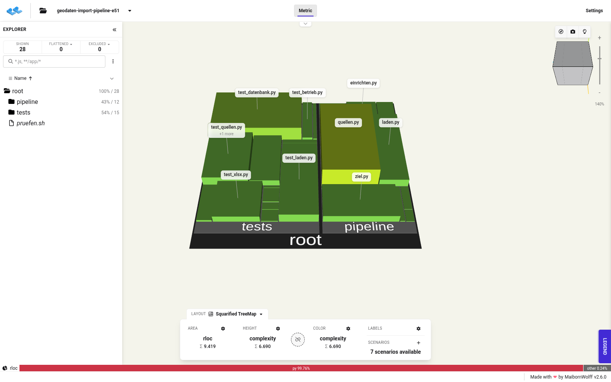

# Code-Karte

Der Code als Stadt: Jede Datei ist ein Gebäude. Die Grundfläche zeigt die Zahl der echten Codezeilen (`rloc`), Höhe und Farbe zeigen die Komplexität (grün einfach, gelb mittel, rot komplex). Ordner sind Stadtviertel.



Stand der Karte: Stand nach E51 vom 07.11.2026, also der Code des Tags `angebot-va-2026-536` bis zum 08.11.2026, vor E52 (Teilbäume `pipeline` 34175c7, `tests` a0630aa). Erfasst sind 28 Dateien: 12 in `pipeline/` mit 4.065 echten Codezeilen und 3.576 Kommentarzeilen, 15 in `tests/` mit 5.332 Codezeilen, dazu `pruefen.sh`. Die frühere Karte vom 02.11. (2.139 Codezeilen, 307 Kommentarzeilen) ist ersetzt; der Zuwachs kommt aus E44 bis E51 und aus der Kommentierung in E49.

So liest man das Bild: `pipeline/quellen.py` ist die komplexeste Datei. Dort liegen der sichere Abruf (nur https, keine Weiterleitungen, Größenbegrenzung, robots.txt-Sperrliste mit benannter Freigabe), das abgesicherte XML- und XLSX-Lesen, das ZIP-Lesen mit Grenzen gegen ZIP-Bomben und die Adapter (WFS, OGC API - Features, CSV, XLSX, INKAR). Daneben `laden.py` (Ablauf eines Laufs, Zeitbudget je Quelle) und `ziel.py` (Abgleich und Schreiben in die Bestandstabellen). Die Tests liegen als eigenes Viertel daneben, `test_datenbank.py` ist dort die größte Datei.

## Dateien

| Datei | Inhalt |
|---|---|
| `geodaten-import-pipeline-angebot-va-2026-536.cc.json.gz` | Karte im CodeCharta-Format (API 2.0) |
| `….sha256` | Prüfsumme der Karte |
| `meta.json` | Stand, Commit, Werkzeug mit Image-Digest |
| `….png` | Vorschaubild |

## Erzeugung

Mit [CodeCharta](https://github.com/MaibornWolff/codecharta) (BSD-3-Clause), Analyse im Container ohne Netz (`--network none`) aus einem Abzug des gestagten Stands (`git checkout-index`) ohne `beispielberichte/` und `docs/codekarte/`. Keine Git-Kennzahlen und keine Autorennamen: Veröffentlicht ist ein einziger Commit (E43), Git-Kennzahlen wären leer.

```
codecharta/codecharta-analysis@sha256:ae97d9425ef81c00b52947a1d9d1c7cad1346204a3a288ef4fb90f07b7efd2b1
ccsh unifiedparser <abzug> -o geodaten-import-pipeline-angebot-va-2026-536.cc.json.gz
```

## Ansehen

Der Viewer läuft lokal und schickt die Karte nirgendwohin:

```
docker run --rm -p 127.0.0.1:8597:80 -v "$PWD/docs/codekarte:/usr/share/nginx/html/daten:ro" \
  codecharta/codecharta-visualization@sha256:5e74d156dec7e07cf12c8475385c3c28374cc1dbb28153e5cfb0da3f7673d122
```

Dann im Browser öffnen:
http://127.0.0.1:8597/?file=/daten/geodaten-import-pipeline-angebot-va-2026-536.cc.json.gz&area=rloc&height=complexity&color=complexity
