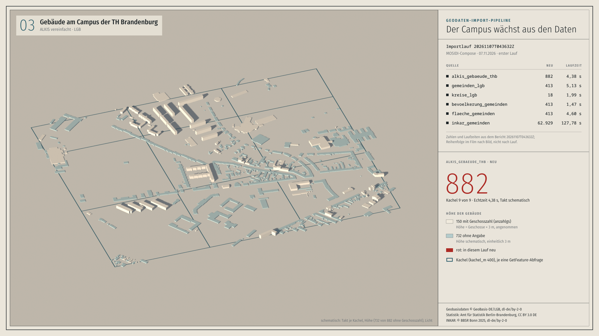

# Film: Der Campus wächst aus den Daten



`film.mp4` (39,1 s, 1920×1080, 30 fps, H.264, yuv420p) · `film.gif` (600 px breit, 8 fps, für die README)

## Was der Film zeigt

Der Erstlauf der Pipeline im MOSIDI-Compose vom 07.11.2026 (Bericht `20261107T043632Z`, 145,36 s), als Karte erzählt, danach der Folgelauf (`20261107T043901Z`, 141,8 s).

1. **Kreise und Gemeinden** (0 bis 9 s): Die 18 Kreise zeichnen sich, dann füllen sich die 413 Gemeinden. Neu Eingelesenes leuchtet zuerst rot und nimmt dann die Farbe seiner Einwohnerdichte an. Die Dauer jeder Phase entspricht der gemessenen Laufzeit der Quelle (1,99 s und 5,13 s).
2. **INKAR** (9 bis 14 s): Der Zähler läuft bis 62.929, im Zeitraffer (127,78 s in 4 s).
3. **Gebäude am Campus der TH Brandenburg** (14 bis 25 s): Die Kamera fährt hinunter auf die BBOX des Campus. Die 9 Kacheln der Abfrage erscheinen nacheinander, die 882 Gebäude wachsen in Echtzeit (4,38 s) aus dem Boden.
4. **Folgelauf** (25,5 bis 34 s): Ein Strahl fährt über Campus und Land, die Tabelle wechselt auf `unverändert` und bestätigt Quelle für Quelle. Erst wenn alle 6 Quellen abgeglichen sind (31,8 s), erscheinen Gesamtlaufzeit, Ergebnis (0 neu, 0 geändert, 0 gelöscht) und Bericht.
5. **Abspann** (33,7 bis 39,1 s): Laufzeiten, Repo und Namensnennungen.

## Woher jede Zahl kommt

| Im Bild | Datei, Feld |
|---|---|
| Lauf-ID, 145,36 s, neu je Quelle (882, 413, 18, 413, 413, 62.929), Laufzeit je Quelle (4,38 / 5,13 / 1,99 / 1,47 / 4,60 / 127,78 s) | `beispielberichte/pruefstand-2026-11-07-e51/mosidi-compose/20261107T043632Z.json`, Felder `laufzeit_s`, `quellen[].zaehler.neu`, `quellen[].laufzeit_s` (gleich `.txt`) |
| Folgelauf: Lauf-ID, 141,8 s, unverändert je Quelle, 0 neu / 0 geändert / 0 gelöscht, „fehlgeschlagen: keine · unvollständig: keine“ | `…/mosidi-compose/20261107T043901Z.json`, Felder `laufzeit_s`, `quellen[].zaehler`, `fehlgeschlagen`, `unvollstaendig` (gleich `.txt`) |
| „abgelegte Datei inkar_2025.zip“ | `20261107T043632Z.txt`, Hinweis bei `inkar_gemeinden` |
| BBOX 332000, 5809400, 333200, 5810400; `kachel_m 400`, 9 Kacheln, je eine GetFeature-Abfrage | `config/pruefkonfiguration.yaml`, Quelle `alkis_gebaeude_thb`; die letzte Abfrage ist zeichengleich mit `letzte_abfrage` im Bericht (die oberste Kachelreihe ist 200 m hoch, weil die BBOX 1000 m misst) |
| Gemeinde- und Kreisgrenzen, Gebäudegrundrisse | Abruf mit den Adaptern der Pipeline (`holen.py`), © GeoBasis-DE/LGB, dl-de/by-2-0 |
| 150 Gebäude mit Geschosszahl, 732 ohne Angabe | Attribut `anzahlgs` der 882 Gebäude aus demselben Abruf, gezählt in `prep.py` |
| Einwohner je km², Anzahl je Klasse (136 / 119 / 65 / 48 / 45 Gemeinden), Summe 2.551.889 Einwohner und 29.654,42 km² | `bevoelkerung` (Stichtag 31.12.2025) und `flaeche_km2` (Stichtag 31.12.2024) aus `SB_A01-04_00_2025j01_BB.xlsx`, gelesen mit dem XLSX-Adapter der Pipeline (Amt für Statistik Berlin-Brandenburg, CC BY 3.0 DE); Klassen und Summen gerechnet in `prep.py` |
| Klassengrenzen 25 / 50 / 100 / 250 Einwohner je km² | gesetzt für die Darstellung, nicht aus den Daten |
| Koordinatengitter, Maßstab, Nordpfeil | aus der Kamera berechnet (EPSG:25833) |

Die Zahlen aus den Berichten stehen fest in `overlay.py` (Liste `QUELLEN`, Texte im Schriftfeld) und `zeitplan.py` (`LZ`); die übrigen rechnet `prep.py` aus den Daten.

## Was schematisch ist

Im Film steht unten rechts jeweils ein Hinweis „schematisch“.

- **Reihenfolge und Takt**: Kreise, Gemeinden und Gebäude kamen jeweils gebündelt (Kreise und Gemeinden je in einer Abfrage, Gebäude in 9 Kachelabfragen). Der Film verteilt sie über die gemessene Laufzeit. Die Reihenfolge der Quellen folgt dem Bild, nicht dem Lauf.
- **Bevölkerung und Fläche** zählen im Bild zusammen mit den Gemeinden hoch; im Lauf sind es eigene Quellen mit eigener Laufzeit (die Tabelle nennt sie).
- **INKAR-Punkte**: Die fliegenden Punkte sind Darstellung. Der Zähler steht im Bericht; Werte je Gemeinde zeigt der Film nicht.
- **Gebäudehöhen**: Es gibt keine Höhe in Metern. 150 Gebäude stehen mit `anzahlgs` × 3 m (angenommen), die 732 ohne Angabe einheitlich mit 3 m.
- **Licht, Farben, Strahl**: Der Strahl im Folgelauf steht für den Abgleich, der in Wirklichkeit über den fachlichen Schlüssel läuft.

## Neu bauen

Alle Befehle aus der Repo-Wurzel. Zwischenstände landen unter `berichte/film-blender/` (nicht versioniert). Geodaten gehören nicht ins Repo.

1. **Daten holen** (Netz: `isk.geobasis-bb.de`, `download.statistik-berlin-brandenburg.de`; nutzt die Adapter und die Prüfkonfiguration der Pipeline):

   ```sh
   uv run --no-project --with-requirements requirements.txt python -I -B docs/filme/blender/holen.py berichte/film-blender/daten
   ```

   Ergebnis: `gebaeude.geojson`, `gemeinden.geojson`, `kreise.geojson` (EPSG:25833) und `abruf-protokoll.json`. Wer die Dateien schon hat, legt sie einfach in einen Ordner und gibt ihn bei Schritt 2 an.

2. **Geometrie vorbereiten** (vereinfachen, triangulieren, Ursprung auf Campusmitte; braucht `numpy`, `shapely`, `mapbox-earcut`):

   ```sh
   python3 docs/filme/blender/prep.py --daten berichte/film-blender/daten --aus berichte/film-blender/prep
   ```

3. **Szene rendern** (Blender 5.1, Eevee, 958 Bilder; ab 31,9 s steht das Bild):

   ```sh
   flatpak run org.blender.Blender -b --python "$PWD/docs/filme/blender/szene.py" -- \
     --prep "$PWD/berichte/film-blender/prep" --aus "$PWD/berichte/film-blender/frames"
   ```

   Flatpak löst einen relativen Pfad bei `--python` gegen `/app/blender` auf, deshalb absolute Pfade. Gleichwertig ist das Python-Modul `bpy` 5.1.2 (`pip install bpy==5.1.2`, Python 3.13): `python szene.py --prep … --aus …`.
   Hinweis zum Bau am 08.11.2026: Flatpak-Blender fiel auf Software-Rendering (llvmpipe, rund 5 s je Bild) zurück, weil die NVIDIA-GL-Erweiterung des Flatpaks nicht zum Treiber des Rechners passte. Gerendert wurde deshalb mit `bpy` 5.1.2 auf der GPU (GTX 1660 Ti, rund 0,4 s je Bild, gut 6 min). Ein Probebild aus beiden Wegen war praktisch gleich (PSNR 69 dB).

4. **Beschriftung darüberlegen** (pycairo, Schriften Fira Sans Condensed und Noto Sans Mono; seriell gut 4 min, `--jobs N` für mehrere Prozesse):

   ```sh
   python3 docs/filme/blender/overlay.py --prep berichte/film-blender/prep \
     --ein berichte/film-blender/frames --aus berichte/film-blender/komp
   ```

5. **Film und GIF**:

   ```sh
   ffmpeg -framerate 30 -i berichte/film-blender/komp/o_%04d.png -c:v libx264 -preset slow -crf 18 \
     -tune animation -pix_fmt yuv420p -r 30 -movflags +faststart docs/filme/blender/film.mp4
   ffmpeg -i docs/filme/blender/film.mp4 -vf "fps=8,scale=600:-1:flags=lanczos,split[a][b];[a]palettegen=max_colors=64:stats_mode=diff[p];[b][p]paletteuse=dither=bayer:bayer_scale=5:diff_mode=rectangle" docs/filme/blender/film.gif
   cp berichte/film-blender/komp/o_0735.png docs/filme/blender/standbild.png
   ```

`zeitplan.py` hält Zeiten, Kamera und Licht für Szene und Beschriftung gemeinsam, damit beide Bild für Bild übereinstimmen.

## Namensnennung

- Geobasisdaten: © GeoBasis-DE/LGB, dl-de/by-2-0
- Statistik: Amt für Statistik Berlin-Brandenburg, CC BY 3.0 DE
- INKAR: © BBSR Bonn 2025, dl-de/by-2-0

Skript und Film: André Stiebitz, Stiebitz Souverain Systems UG, mit KI-Unterstützung erstellt.
