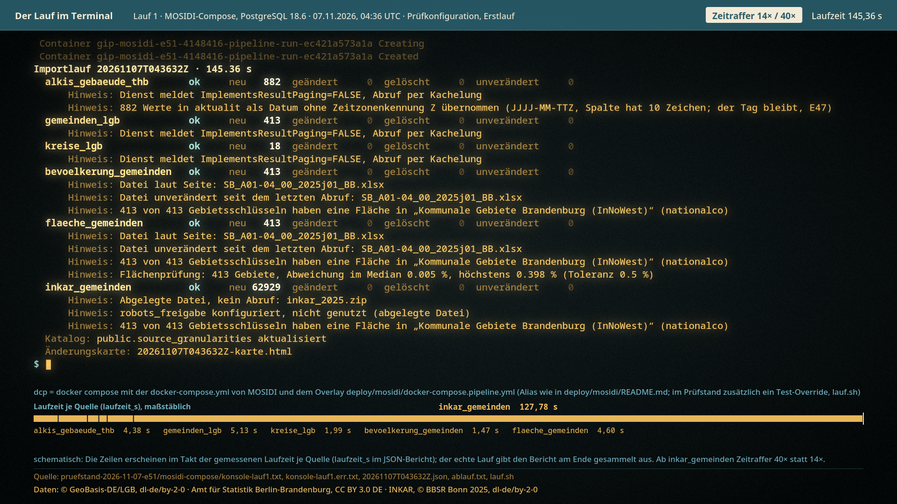

# Film: Der Lauf im Terminal



`film.mp4` (38,6 s, 1920×1080, 30 fps, H.264) · `film.gif` (960 px breit, 10 fps, für die README)

## Was der Film zeigt

1. **Lauf 1 (Erstlauf)** der Pipeline im MOSIDI-Compose mit der Prüfkonfiguration, 07.11.2026, 04:36 UTC, PostgreSQL 18.6. Der Befehl, die Containerzeilen von docker compose und der Importbericht stehen so im Terminal, wie sie in den Konsolenmitschnitten stehen; gekürzt sind nur Warnzeilen von docker compose (siehe „Was schematisch ist“).
2. **Lauf 2 (Folgelauf)** direkt danach mit derselben Konfiguration: alles `unverändert`. Lauf 1 steht gedämpft darüber.
3. **Fehlerfall** aus dem Prototyp vom 30.10.2026: eine absichtlich unerreichbare Quelle (`wfs.example.invalid`) bricht ab, die übrigen Quellen laufen durch, und die Pipeline legt einen Meldungsentwurf an den Anbieter ab. Der Entwurf wird rechts als Ausdruck gezeigt.
4. **Vollumfang INKAR** aus dem eigenen Prüfstand (nicht im MOSIDI-Compose gemessen): Erstlauf und Folgelauf, Wertabgleich je Zeile, Testzahlen. Der Folgelauf dauerte länger als der Erstlauf, obwohl nichts geändert wurde; das Bild nennt dazu die Rechnerlast vor beiden Läufen aus `ablauf.txt` (vor dem Folgelauf 3,84 / 5,90 / 6,17, vor dem Erstlauf 2,13 / 1,87 / 1,85, Lastmittel 1/5/15 min, 16 Kerne).

## Woher jede Zahl kommt

Das Skript liest alle Texte und Zahlen beim Rendern aus `beispielberichte/` und prüft sie mit `assert`, zum Beispiel dass der Konsolenmitschnitt dem Bericht entspricht. `python3 docs/filme/terminal/film.py --manifest` gibt jede verwendete Zahl als JSON aus.

| Im Bild | Datei |
|---|---|
| Befehl, Argumente | `pruefstand-2026-11-07-e51/mosidi-compose/ablauf.txt`, `lauf.sh` |
| Containerzeilen | `…/mosidi-compose/konsole-lauf1.err.txt`, `konsole-lauf2.err.txt` |
| Bericht Lauf 1 (145,36 s) | `…/mosidi-compose/20261107T043632Z.txt` (gleich `konsole-lauf1.txt`) |
| Bericht Lauf 2 (141,8 s) | `…/mosidi-compose/20261107T043901Z.txt` (gleich `konsole-lauf2.txt`) |
| Laufzeit je Quelle, Zeitleiste | `laufzeit_s` in den zugehörigen `.json` |
| Fehlerfall (5,2 s) | `20261030T074610Z.txt`, `.json` |
| Meldungsentwurf | `20261030T074610Z-meldung-kaputte_quelle.txt` (Text unverändert) |
| 33 547 606 Zeilen, 7783,14 s und 9582,77 s | `pruefstand-2026-11-07-e51/quellen/20261107T044222Z.txt`, `20261107T065227Z.txt` |
| 0 / 0 / 0, 16 Länder | `pruefstand-2026-11-07-e51/wertabgleich/ergebnis-vollumfang.txt` |
| Rechnerlast vor Erst- und Folgelauf | `pruefstand-2026-11-07-e51/quellen/ablauf.txt` |
| 424 Tests | `pruefstand-2026-11-07-e51/pruefen.log` |
| 70 von 70 auf PostgreSQL 16.15 und 18.6 | `pruefstand-2026-11-07-e51/datenbanktests.log` |
| Namensnennungen in der Fußzeile | je Szene nur für die gezeigten Quellen, Spalte Lizenz des passenden Quellenverzeichnisses: Lauf 1 und 2 `…/mosidi-compose/quellenverzeichnis.md`, Fehlerfall `beispielberichte/quellenverzeichnis.md`, Vollumfang `pruefstand-2026-11-07-e51/quellen/quellenverzeichnis.md` |

Die Minutenangaben (129,7 min und 159,7 min) sind aus den Sekunden der Berichtsköpfe umgerechnet.

## Was schematisch ist

Im Film steht dazu jeweils ein Hinweis „schematisch“.

- **Takt der Zeilen:** Der echte Lauf gibt den Bericht am Ende gesammelt aus. Im Film erscheint jede Quelle nach ihrer gemessenen Laufzeit (`laufzeit_s`), im Zeitraffer: Lauf 1 14×, ab `inkar_gemeinden` 40×, Lauf 2 48×, Fehlerfall Echtzeit. Die Uhr oben rechts folgt der gemessenen Laufzeit. Die Zeile „läuft … s“ während einer Quelle ist Darstellung, keine Ausgabe der Pipeline.
- **Ausdruck:** Der Meldungsentwurf ist als Endlospapier gezeichnet, die Markierung von Befund, Zeitpunkt und Abfrage ist nachträglich. Die Pipeline versendet nichts automatisch.
- **Gekürzt:** Die Konsolenmitschnitte `konsole-lauf1.err.txt` und `konsole-lauf2.err.txt` enthalten außer den Containerzeilen zwei Warnzeilen von docker compose (`GEOSERVER_ADMIN` und `GEOSERVER_PASSWORD` nicht gesetzt). Der Film zeigt nur die Containerzeilen.
- **Umbruch:** Im Fehlerfall ist die Terminalspalte schmaler, lange Berichtszeilen sind dort umbrochen. Der Text bleibt wörtlich.
- **Hochzählen:** Die große Zahl im Schlussbild zählt hoch, der Endwert steht wörtlich in der Datei.

## Daten

Der Film zeigt nur Berichtstexte, keine Karten. Er braucht keine Geodaten und lädt nichts aus dem Netz. Die Berichte nennen Quellen dieser Anbieter: © GeoBasis-DE/LGB, dl-de/by-2-0 · Amt für Statistik Berlin-Brandenburg, CC BY 3.0 DE · INKAR, © BBSR Bonn 2025, dl-de/by-2-0 · © BKG (2026) dl-de/by-2-0 (nur im Fehlerfall, Quelle `kreise_bkg`). Im GIF ist die Fußzeile mit den Namensnennungen klein; sie gelten auch dort.

## Neu bauen

Voraussetzungen: Python 3 mit `pycairo`, `numpy`, `Pillow`; `ffmpeg` mit libx264; die Schriften Noto Sans und Noto Sans Mono.

```sh
# aus der Repo-Wurzel
python3 docs/filme/terminal/film.py --check       # Beschriftung: Rand, Überlappung
python3 docs/filme/terminal/film.py               # film.mp4 (H.264, yuv420p, +faststart)
python3 docs/filme/terminal/film.py --gif         # film.gif aus film.mp4
python3 docs/filme/terminal/film.py --standbild   # standbild.png
python3 docs/filme/terminal/film.py --still 9.5   # Probebild probe-9.5.png
```

Mit `--berichte <ordner>` liest das Skript die Berichte aus einem anderen Ordner (Standard: `beispielberichte/` der Repo-Wurzel). `--jobs <n>` rechnet die Bilder parallel; geht das nicht, rechnet es seriell. Das GIF entsteht mit ffmpeg (10 fps, 960 px, eigene Palette mit 64 Farben, Bayer-Dithering), der genaue Filter steht in `render_gif()`.

Skript und Film: André Stiebitz, Stiebitz Souverain Systems UG, mit KI-Unterstützung erstellt.
